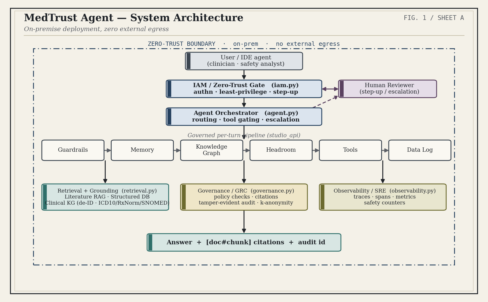
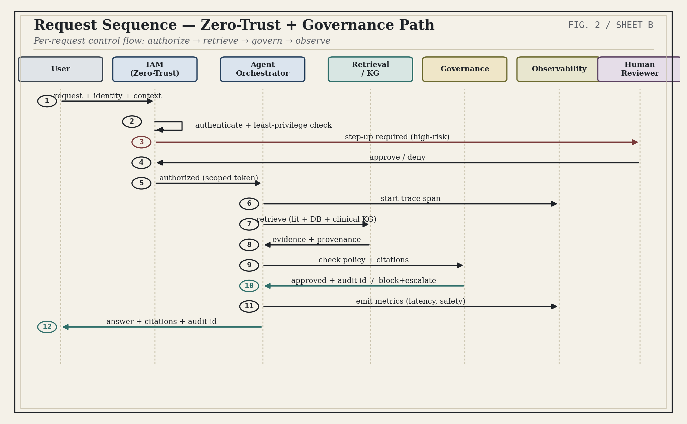
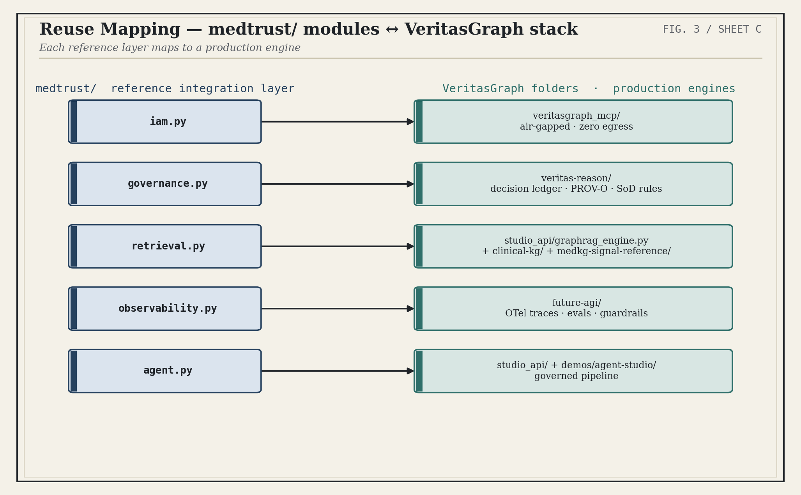
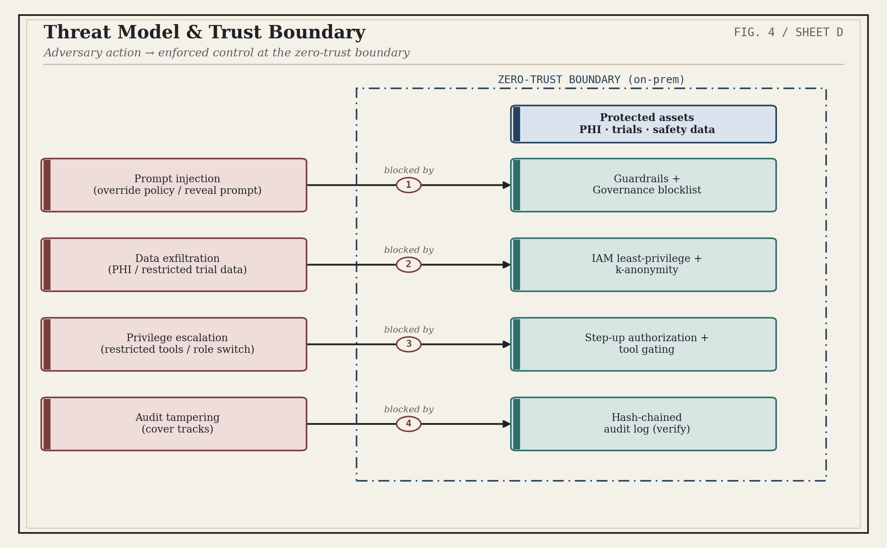
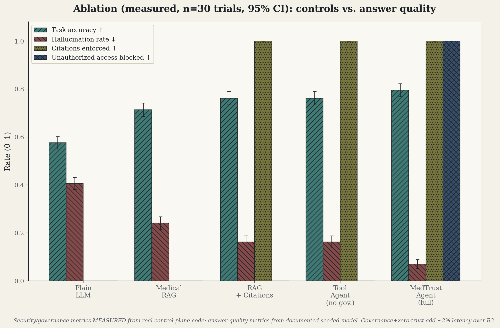
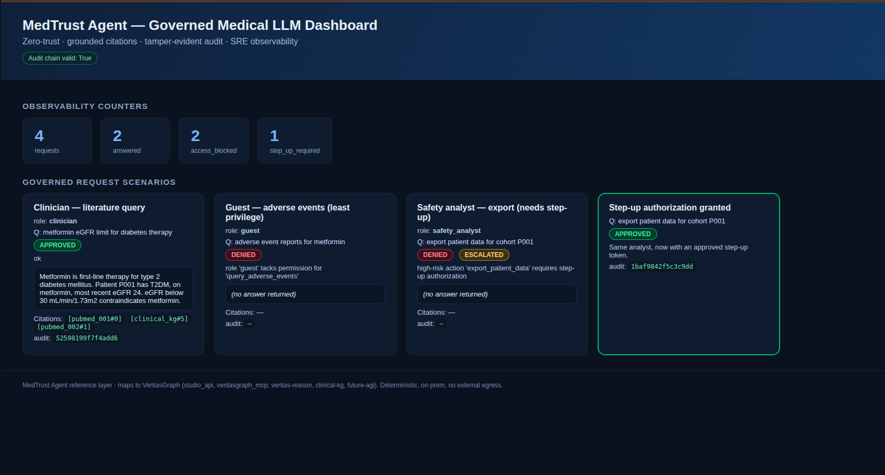

# MedTrust Agent

**A Zero-Trust, Observable LLM Agent Framework for Medical and Pharmaceutical Workflows**

> In regulated healthcare, a good answer is not enough — the system also has to prove
> **who was allowed to ask**, **where the answer came from**, and **that the record
> can't be quietly changed**. MedTrust Agent makes those properties *testable*.

[](https://www.python.org/downloads/)
[](tests/)
[](#quick-start)
[](#architecture)

**Paper:** *MedTrust Agent: A Zero-Trust, Observable LLM Agent Framework for Medical and
Pharmaceutical Workflows* — NEECON 2026, Dubai (Oct 21–23, 2026), Paper #1571353697.

This work is a **peer-reviewed research paper**, published in the technical program of the
**2026 International Near East Conference on Electrical & Energy Systems (NEECON)**:

> **TS3: Technical Session TS3 — Artificial Intelligence**
> Wednesday, October 21, 4:30–6:30 · Room: Fursa Ballroom A
> Chair: Siddharth Joshi (Pandit Deendayal Energy University & APA Energy, India)
> **MedTrust Agent: A Zero-Trust, Observable LLM Agent Framework for Medical and
> Pharmaceutical Workflows** — Bibin Prathap (Abu Dhabi Executive Office, United Arab Emirates)
> Paper record: <https://edas.info/p35211>

MedTrust Agent is an **example implementation** of the governed-agent architecture
described in the [VeritasGraph](../README.md) project. It reuses the VeritasGraph
stack's design principles — provenance at write time, deterministic retrieval,
explicit abstention — and adds the control plane that regulated deployments need:
zero-trust IAM, governance/GRC, and SRE-grade observability, unified into **one
evaluable platform**.

---

## Why

Clinical research, pharmacovigilance, and regulatory-intelligence teams want LLM
assistants that reason over trial metadata, adverse-event tables, drug labels, and
literature. Today's production assistants optimize **answer quality alone** and are
weak on exactly the properties regulators mandate (HIPAA, EU AI Act): access control,
auditability, safety, and operational visibility.

**The gap:** there is no end-to-end architecture that joins agentic AI, cybersecurity,
database grounding, cloud/AI infrastructure, zero trust, governance, and observability
into one platform whose safety properties are actually testable. MedTrust Agent closes
that gap.

## Objectives

1. **Unify seven siloed concerns** — agentic orchestration, cybersecurity, database
   grounding, cloud/AI infrastructure, zero-trust IAM, AI governance-risk-compliance,
   and SRE-grade observability — into one evaluable control plane.
2. **Make security properties formal and verifiable** — four stated properties, each
   with an assumption, a mechanism, and a verification.
3. **Ship a reproducible, dependency-light reference implementation** with an honest
   measurement harness — security measured straight from the running code, answer
   quality clearly labelled *illustrative*.

## Architecture

Every request flows through five cooperating layers, in order:

```
authorize → retrieve → govern → observe → answer
```

| Layer | Module | Responsibility | Backed by (VeritasGraph stack) |
|-------|--------|----------------|-------------------------------|
| Agent orchestration | `agent.py` | Task routing, tool gating, escalation, end-to-end flow | `studio_api/` per-turn pipeline |
| Zero-Trust / IAM | `iam.py` | Least-privilege authz, step-up for high-risk actions | `veritasgraph_mcp/` (air-gapped, zero egress) |
| Retrieval + grounding | `retrieval.py` | Literature RAG + structured grounding with `[doc#chunk]` citations | `studio_api/graphrag_engine.py`, `clinical-kg/` |
| Governance / GRC | `governance.py` | Policy checks, mandatory citations, keyed hash-chained audit log | `veritas-reason/` (decision ledger, PROV-O) |
| Observability / SRE | `observability.py` | Spans, counters, policy-decision events | `future-agi/` (OTel-native) |

**Key rule:** *no tool runs before authorization succeeds.* High-risk actions
(`EXPORT_PATIENT_DATA`, `CLEAR_GRAPH`) require a valid step-up token; without it the
request is denied and audited.

## Diagrams (publication figures)

The five figures below are the publication figures generated from the reference
implementation (`diagrams.py`) and used in the research paper. Each is available as
PDF (for the IEEE camera-ready manuscript) and PNG (for docs/slides) under
[`diagrams/`](diagrams/).

### Figure 1 — System Architecture

The five cooperating layers: agent orchestration, zero-trust IAM, retrieval/grounding,
governance, and cross-cutting observability.


([PDF](diagrams/diagram1_system_architecture.pdf))

### Figure 2 — Request Sequence

Per-request control flow: authorize → retrieve → govern → observe, including the
step-up authorization branch and human-review escalation.


([PDF](diagrams/diagram2_request_sequence.pdf))

### Figure 3 — Module Mapping

How each `medtrust/` module maps to a production engine in the VeritasGraph framework
— the reuse path from research prototype to production.


([PDF](diagrams/diagram3_module_mapping.pdf))

### Figure 4 — Threat Model

Adversary vectors (privilege escalation, data exfiltration, destructive actions, audit
tampering, prompt injection) and the control that blocks each one.


([PDF](diagrams/diagram4_threat_model.png))

### Figure 5 — Results / Ablation

Ablation across the five configurations (B0 Plain LLM → MT Full MedTrust Agent),
showing measured security gains and the illustrative quality track.


([PDF](diagrams/diagram5_results_ablation.pdf))

### Dashboard

Rendered dashboard of the governed flow (approved answers with citations, zero-trust
denials, step-up authorization, audit chain):



To regenerate all figures: `python diagrams.py` (or run `./reproduce.sh`, which also
syncs the PDFs into the paper's `graphics/` directory).

## Formal Properties

| # | Property | Mechanism | Verification |
|---|----------|-----------|--------------|
| P1 | **Least privilege** | No tool before auth; high-risk needs step-up | IAM conformance over full role × action × step-up space |
| P2 | **Citation-grounded output** | Uncited answers withheld or routed to human review | Governance engine over released answers |
| P3 | **Tamper-evident audit** | HMAC chain + published anchors | Mutation / truncation / recompute / rollback tests |
| P4 | **Bounded egress** | No patient data leaves without a recorded decision | Export-path tests |

> **Precision on P3:** we claim tamper-*evidence* **under key secrecy**, not
> "provable immutability." If an insider holds the HMAC key, they can forge
> consistently — that is stated out of scope and demonstrated with a test.

Every control is mapped to **HIPAA**, the **EU AI Act**, **NIST SP 800-207**, and the
**NIST AI RMF**.

## Results (honest split: measured vs. illustrative)

| Result | Status | Value |
|--------|--------|-------|
| Unauthorized / high-risk actions blocked | **Measured** | `100%` (Wilson 95% CI) |
| Citations enforced on released answers | **Measured** | `100%` |
| Audit tamper-evidence (mutation/truncation/recompute/rollback) | **Measured** | Detected in all cases |
| One-shot prompt injection blocked | **Measured** | `100%` |
| IAM spec conformance (role × action × step-up, n=50) | **Measured** | `100%`, false-denial `0%` |
| Adaptive attacker vs. content filter *alone* | **Measured (negative finding)** | Bypass `0% → 46.4% → 100%` over 3 rounds |
| Control-plane latency overhead vs. tool-agent baseline | **Measured** | ≈ `1.5×` on a **microsecond** base (< 0.01% of LLM inference) |
| Answer accuracy / hallucination | **Illustrative (seeded model)** | `+21.9` accuracy pts, `−33.5` hallucination pts vs. plain LLM |

The **negative finding is deliberate and reported openly**: a content filter alone is
defeated by an adaptive attacker. That is precisely why MedTrust never relies on the
filter alone — it **composes** the filter with IAM, grounding, mandatory citation, and
human review. Defense-in-depth is the design conclusion, and the data earns it.

**Fair comparison:** baseline B3 (tool agent) shares the identical retrieval and
citation stack with MedTrust and differs *only* by the IAM and governance layers — so
the experiment isolates the true cost and benefit of the control plane.

## Quick Start

```bash
# 1. End-to-end reference demo (no network, no models)
python -m medtrust.demo

# 2. Full reproduction: tests + metrics + latency + security + figures
./reproduce.sh
SEED=7 TRIALS=30 ./reproduce.sh

# 3. Web dashboard (governed answers, denials, step-up, audit chain)
uvicorn medtrust.web:app --port 8400

# 4. Clinical-information-system themed dashboard (alternate front-end)
uvicorn medtrust.web_clinical:app --port 8410
```

Dependencies (offline reproduction): `matplotlib`, `numpy`, `pytest` — see
[`requirements.txt`](requirements.txt). The core control plane is **stdlib-only**.

### Live-LLM track (real model + public data)

The answer-quality track is illustrative offline; swap in any OpenAI-compatible
endpoint (Ollama, vLLM, llama.cpp, Azure, OpenAI) without changing the control plane:

```bash
export MEDTRUST_LLM_URL=http://localhost:11434/v1   # e.g. Ollama
export MEDTRUST_LLM_MODEL=llama3
```

See [`llm.py`](llm.py) — `OpenAICompatibleClient` + `evaluate_live` run the same
scenario suite with the real IAM/governance/audit layers and only the generator swapped.

## Evaluation

- **40 labelled scenarios across 6 categories** (clinical QA, pharmacovigilance,
  trial access, PHI handling, prompt injection, privilege escalation) over
  **30 seeded trials** — versioned in [`scenarios/scenarios.jsonl`](scenarios/scenarios.jsonl).
- **Ablation across 5 balanced configurations** (B0 Plain LLM → B1 Medical RAG →
  B2 RAG+Citations → B3 Tool Agent → MT Full MedTrust Agent); only the control plane
  varies, so differences are attributable to the controls.
- **Wilson 95% confidence intervals** over independent cases for all security rates.
- **Adversarial suite** in [`eval/attacks.py`](eval/attacks.py): prompt-injection
  benchmark (direct / indirect / exfiltration / jailbreak families), adaptive attacker
  rounds, false-denial probes, and IAM specification conformance.

### Reproduction outputs

| File | Contents |
|------|----------|
| `results/metrics.json` | Ablation (measured security + illustrative quality), 95% CI |
| `results/latency.json` | Per-component absolute latency (IAM ≈ 0.8 µs, governance+audit ≈ 2.5 µs) |
| `results/security.json` | Injection benchmark, adaptive attack, false-denial, conformance |
| `diagrams/diagram*.pdf/png` | Five publication figures (architecture, sequence, mapping, threat model, ablation) |

## File Map

```
MedTrust Agent/
  agent.py            orchestration: route → authorize → retrieve → govern → observe
  iam.py              zero-trust / least-privilege + step-up
  retrieval.py        grounding + [doc#chunk] citations
  governance.py       policy + keyed, anchored, tamper-evident audit
  observability.py    spans + counters
  benchmark.py        ablation + per-component latency → results/*.json
  eval/attacks.py     injection benchmark + adaptive attack + conformance + FNR
  eval/stats.py       Wilson / bootstrap intervals
  llm.py              optional live-LLM adapter (public data)
  diagrams.py         5 figures (editorial theme)
  web.py              FastAPI dashboard (governed flow screenshots)
  web_clinical.py     CIS-themed alternate dashboard
  screenshots.py      Playwright capture + behavior assertions
  scenarios/          versioned 40-scenario suite
  tests/              69 tests (unit + audit + security)
  reproduce.sh        one-command reproduction
  ARTIFACT.md         full reproducibility artifact description
  DIAGRAMS.md         rendered figure index
  FIGURES.md          dashboard screenshot index
```

## Limitations (stated up front)

- The **quality track is illustrative** — from a seeded model, with a drop-in
  live-LLM adapter to re-run on public data.
- Scenarios **over-represent adversarial traffic**, so security rates are best read
  as *conditional on an attack of that family*.
- IAM conformance is **exhaustive over the specified policy**; the harness re-runs
  whenever the policy changes.
- Audit tamper-evidence is **conditional on key secrecy** and anchors being published
  to a trusted append-only sink.

## Related

- **[VeritasGraph](../README.md)** — the governed, on-prem GraphRAG & agent framework
  this implementation exemplifies.
- **[Awesome-AI4Med](../Awesome-AI4Med/)** — curated AI4Med research resources, plus
  the NEECON 2026 presentation materials (`MedTrust_NEECON2026.pptx`,
  `PRESENTATION_SPEAKER_SCRIPT.md`, `PRESENTATION_QA_BRIEF.md`).
- **[ARTIFACT.md](ARTIFACT.md)** — the full reproducibility artifact for reviewers.

## License

MIT — see the repository root [`LICENSE`](../LICENSE).
