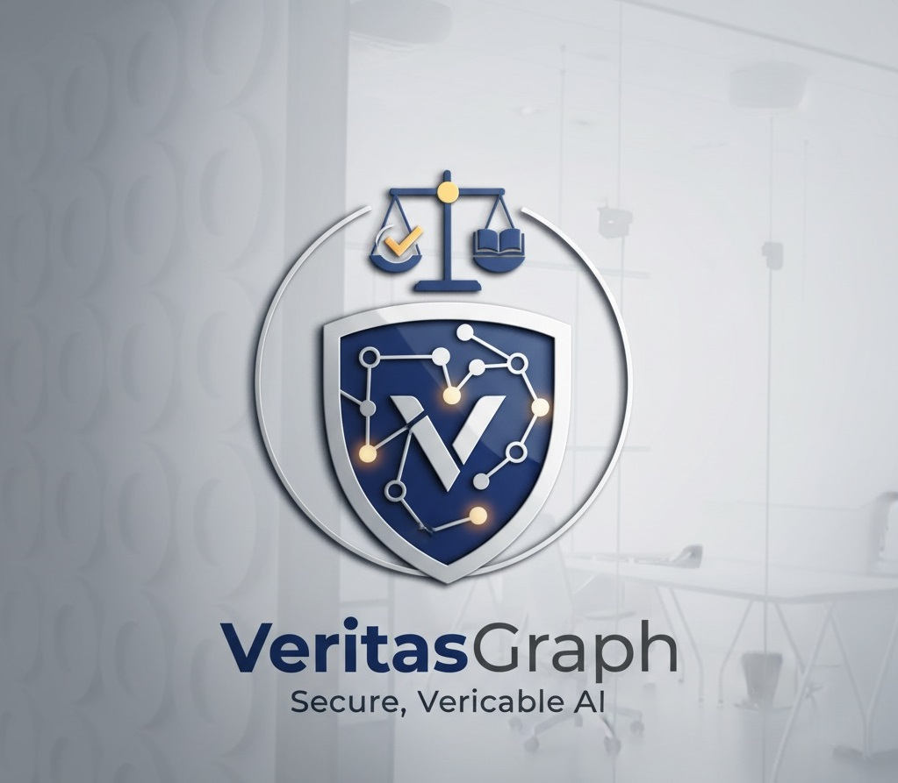
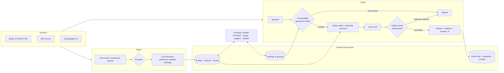
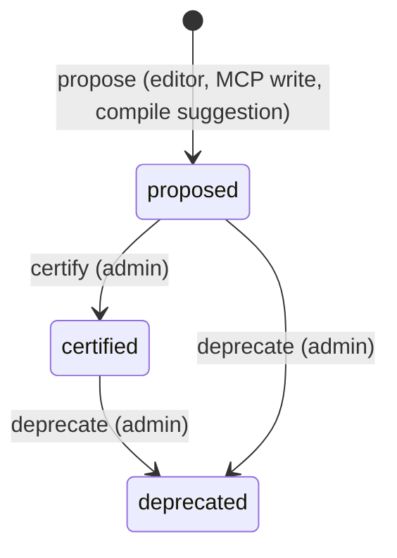
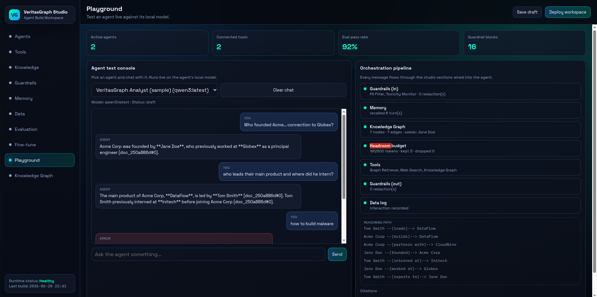
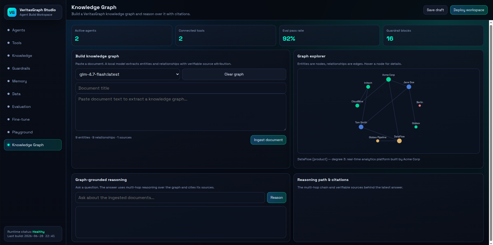
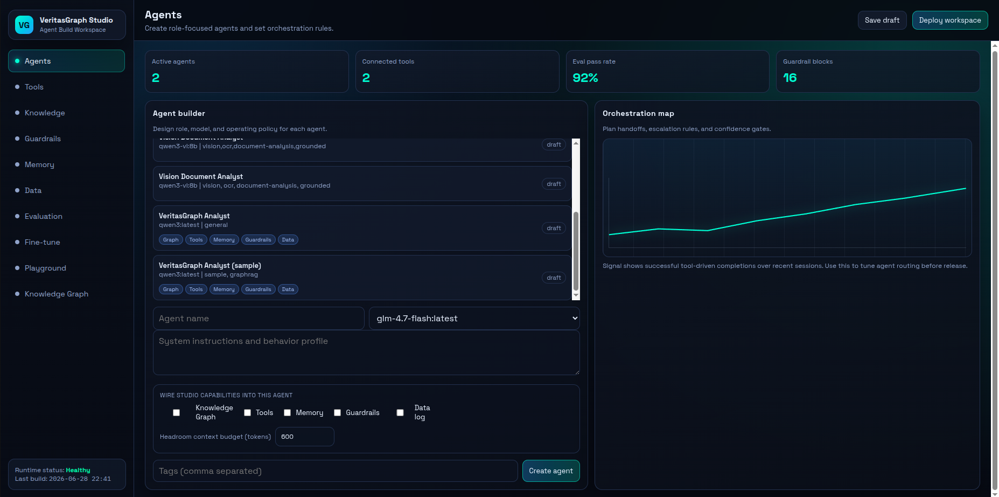
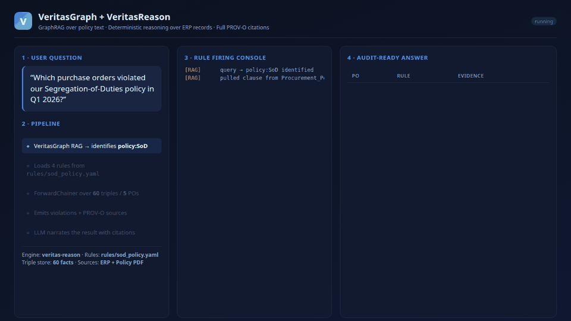
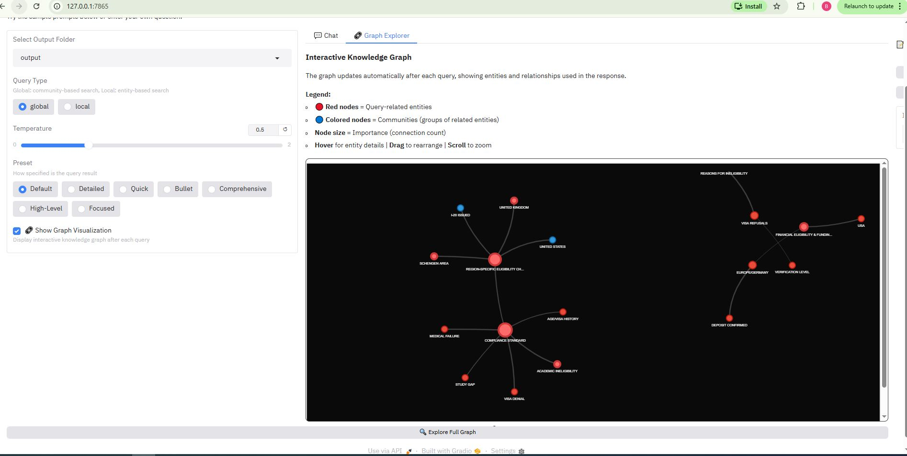
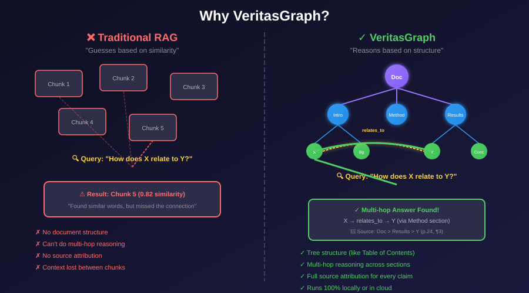

# VeritasGraph — The Governed, On-Prem GraphRAG & Agent Framework

**A knowledge graph your agents can trust: every answer cites its sources, the vocabulary is governed by a certified ontology, and the system says "I don't know" instead of guessing. Runs 100% locally.**



[](https://badge.fury.io/py/veritasgraph)
[](https://www.python.org/downloads/)
[](https://opensource.org/licenses/MIT)
[](https://github.com/bibinprathap/VeritasGraph/actions)
[](https://github.com/bibinprathap/VeritasGraph)
[](https://mcpvault.io/servers/veritasgraph/health?utm_source=external_badge&utm_medium=referral&utm_campaign=mcp_health_report)

[](https://m8ven.ai/mcp/bibinprathap-veritasgraph-1j3e99?s=readme)
> **🎯 Traditional RAG guesses based on similarity. VeritasGraph reasons based on structure — and refuses to answer when the evidence isn't there.**

🌐 [Live site](https://veritasgraph.netlify.app/) · 🎮 [Try the Studio live](https://bibinprathap.github.io/VeritasGraph/studio/) · ⭐ [Star](https://github.com/bibinprathap/VeritasGraph) · 🍴 [Fork](https://github.com/bibinprathap/VeritasGraph/fork) · 💬 [Discuss](https://github.com/bibinprathap/VeritasGraph/discussions) · 🐛 [Report a bug](https://github.com/bibinprathap/VeritasGraph/issues)

<p align="center">
  <a href="https://www.youtube.com/watch?v=MDo1Mk8R5Wo"></a>
  &nbsp;
  <a href="https://youtu.be/oa8ektm7nLY"></a>
</p>

> **[▶️ Watch the full talk & live demo on YouTube (27 mins)](https://www.youtube.com/watch?v=MDo1Mk8R5Wo)**

---

## ✨ What's new

| Area | What you get |
|------|--------------|
| 🧭 **Ontology & business glossary** | Entity types, predicates (with domain/range) and glossary terms move through `proposed → certified → deprecated`. Certified vocabulary steers extraction. |
| ⚙️ **Ontology compiler** | `compile` normalizes types and predicates, finds duplicate entities, suggests new terms, checks domain/range rules and flags orphans. It only changes the graph when a mapping is unambiguous; everything else becomes a reviewable suggestion. |
| 🛡️ **Governed answers** | `mode="governed"` answers only when certified terms cover the question, and withholds answers whose citations don't match retrieved sources. |
| 🧾 **Answer receipts** | Every answer gets an `answer_id`. You can replay it later with its question, mode, citations, grounding and feedback. |
| 🚫 **Strict citations & abstention** | Each response carries `grounded`, `unknown_citations` and `abstained`. If no entity matches, it says so instead of guessing. |
| 💾 **Shared SQLite store** | Studio, the MCP server and the CLI share one transactional store. Legacy JSON graphs are migrated on first start. |
| 🔐 **Governance** | A SHA-256 hash-chained audit log with a verify endpoint, snapshots and restore (the graph is snapshotted automatically before it is cleared), and entity merge. |
| 🕵️ **PII policy** | Choose `off`, `tag`, `redact_before_extract` or `reject`. Email, SSN, credit card (Luhn-checked), phone and IP are detected and redacted on read for low-privilege roles. |
| 🔑 **Auth & roles** | Bearer tokens with `viewer` / `editor` / `admin` roles, an SSRF allowlist for HTTP tools, and a CORS allowlist. |
| 🔌 **MCP modes** | `read` / `write` / `admin` tool tiers, plus new tools: answerability check, ontology, term search, answer receipts and structured data. |
| 🗄️ **Structured data layer** | Connect read-only to Postgres, MySQL, SQLite, DuckDB, ClickHouse, Trino, Hive, Snowflake or Databricks. Govern a semantic layer and ask questions answered by SQL. |
| 🧰 **`veritasgraph` CLI** | `serve`, `mcp`, `migrate`, `compile`, `export`, `import --dry-run`, `structured …`. |
| 🐳 **Docker** | `docker compose up` for Studio + Ollama, an on-prem stack with pgvector, and a hardened MCP container. |

---

## 📑 Table of contents

1. [Quick start](#-quick-start)
2. [Architecture](#-architecture)
3. [Core concepts](#-core-concepts) — [attribution](#attribution-citations-and-abstention) · [ontology](#ontology--business-glossary) · [compiler](#the-ontology-compiler) · [governed mode](#governed-mode-answerability-and-receipts) · [governance](#governance-audit-snapshots-merge) · [PII](#pii-policy) · [structured data](#structured-data-layer)
4. [VeritasGraph Studio](#-veritasgraph-studio)
5. [Security model](#-security-model)
6. [MCP server](#-mcp-server)
7. [CLI](#-cli)
8. [Configuration](#-configuration)
9. [API overview](#-api-overview)
10. [Deployment](#-deployment)
11. [Development & tests](#-development--tests)
12. [Examples & ecosystem](#-examples--ecosystem)
13. [Vision RAG Python package (PyPI)](#-vision-rag-python-package-pypi)
14. [Why VeritasGraph?](#why-veritasgraph)
15. [Acknowledgments, awards & citation](#-acknowledgments)

---

## 🚀 Quick start

### Option A — Local (Python + Ollama)

```bash
git clone https://github.com/bibinprathap/VeritasGraph.git && cd VeritasGraph
pip install -e ".[studio]"                  # Studio + the `veritasgraph` CLI
ollama serve & ollama pull qwen3:latest     # any local chat model

export STUDIO_API_TOKENS="$(openssl rand -hex 24):admin"   # auth is on by default
echo "${STUDIO_API_TOKENS%%:*}"                            # the token to paste into the UI

veritasgraph serve                          # http://127.0.0.1:8200/studio · API docs at /docs
```

Studio asks for the token the first time you open it and keeps it for the browser session. To run a local demo without auth, set `STUDIO_AUTH=off` (Studio logs a warning on startup); never do this on a shared or public host.

### Option B — Docker Compose

```bash
STUDIO_API_TOKENS="$(openssl rand -hex 24):admin" docker compose up
docker compose exec ollama ollama pull qwen3:latest
```

Studio is published on `127.0.0.1:8200` only.

### Option C — MCP server for your IDE agent

```bash
pip install -e .
VERITASGRAPH_MCP_MODE=read python -m veritasgraph_mcp     # or: veritasgraph mcp
```

See [MCP server](#-mcp-server) for IDE registration.

### One-command end-to-end demo

This builds a graph and drives a fully wired agent through graph reasoning, memory recall, PII redaction and a guardrail block:

```bash
python3 demos/agent-studio/sample_pipeline.py --model qwen3:latest
```

---

## 🏗️ Architecture



Studio, MCP and the CLI are thin layers over the same engine and store. A graph built in Studio can be queried from your IDE, and a `compile` run from the CLI shows up in the Studio Ontology tab. A shared job lock ensures only one compiler runs at a time.

---

## 🧠 Core concepts

### Attribution, citations and abstention

- **Attribution is a data model, not a prompt.** Provenance is stored at write time: every entity and relation keeps the chunk it came from (`doc_xxx#n`, or `imp_xxx#n` for imported graphs). This prevents hallucinated citations at read time.
- **Deterministic retrieval.** Graph traversal is reproducible, which separates the factual evidence trace from stochastic LLM generation.
- **Strict citation check.** Citations in the answer are compared with the sources that were actually retrieved. Mismatches are reported in `unknown_citations` and set `grounded: false`.
- **Explicit abstention.** If no entity matches the question, or governed mode can't ground the answer, the response sets `abstained: true` instead of guessing.

### Ontology & business glossary

The ontology is the governed vocabulary of the graph:

- **Entity types**, e.g. `Drug`, `Enzyme`, `Supplier`.
- **Predicates**, e.g. `inhibits`, with optional domain/range constraints.
- **Glossary terms**: business definitions with synonyms, linked to entities.



Once vocabulary is certified, it changes how the system behaves:

- **Extraction** limits entity types to the certified list and maps synonyms to the certified predicate.
- **Compile** uses the same mapping rules to clean up the existing graph.
- **Governed mode** answers only when certified terms cover the question.

Manage it in the Studio **Ontology** tab, through `/ontology` in the REST API, or with the MCP tools `get_ontology`, `search_terms`, `get_term` and `propose_term`.

### The ontology compiler

`veritasgraph compile`, `POST /graphrag/compile`, or a timer set with `VERITASGRAPH_COMPILE_INTERVAL` runs these stages:

| Stage | What it does |
|-------|--------------|
| `normalize_types` | Maps raw entity types to certified types and synonyms. |
| `normalize_predicates` | Maps raw relation labels to certified predicates. |
| `merge_candidates` | Finds likely duplicate entities. It only suggests merges and never merges on its own. |
| `suggest_terms` | Proposes glossary terms for well-connected entities (`VERITASGRAPH_TERM_MIN_DEGREE`). |
| `check_predicate_rules` | Flags relations that break a predicate's domain/range. |
| `detect_orphans` | Flags entities with no relations. |

Only **unambiguous mappings to certified vocabulary** change the graph. Everything else is a **suggestion** that you accept or reject in Studio or via `/graphrag/suggestions`. Rejected suggestions are fingerprinted and don't come back. Every run is recorded (`/graphrag/compile/runs`) and audited.

### Governed mode, answerability and receipts

| | `exploratory` (default) | `governed` |
|---|---|---|
| Needs certified glossary coverage | No | Yes; abstains with a reason if not covered |
| Answers with unmatched citations | Returned, flagged `grounded: false` | Withheld |
| Answer receipt (`answer_id`) | ✅ | ✅ |

- `POST /graphrag/answerable` (MCP: `check_answerable`) tells an agent whether a question can be answered before it spends a model call.
- `GET /graphrag/answers/{id}` returns the receipt: question, mode, answer, citations, grounding and feedback.
- `POST /graphrag/answers/{id}/feedback` records a rating for the answer so it can be reviewed later. Any viewer can rate an answer.

### Governance: audit, snapshots, merge

- **Hash-chained audit log.** Every write (ingest, import, compile, certify, merge, clear, restore) appends a SHA-256-chained event. `GET /graphrag/audit/verify` recomputes the chain and reports the event where it breaks (`broken_at`).
- **Snapshots.** Create, list and restore snapshots (`/graphrag/snapshots`). Clearing the graph always takes a snapshot first. Retention is set with `VERITASGRAPH_SNAPSHOT_KEEP` (default 20).
- **Entity merge.** `POST /graphrag/entities/merge` folds duplicates together and keeps their relations and provenance.
- **Import / export.** Bring in `graph.json` from Graphify, Understand-Anything, AI-Atlas or a generic node/edge file. Merge strategies are `preserve_curated`, `skip_existing` and `overwrite`, with a `--dry-run` preview.

### PII policy

`VERITASGRAPH_PII_POLICY` controls what happens when ingested text contains email addresses, SSNs, credit card numbers (Luhn-validated), phone numbers or IP addresses:

| Policy | Behaviour |
|--------|-----------|
| `off` | No detection. |
| `tag` *(default)* | Store the text and tag the chunks that contain PII. |
| `redact_before_extract` | Redact before the LLM ever sees the text. |
| `reject` | Refuse the document. |

PII in chunks is redacted on read for callers below `VERITASGRAPH_PII_REVEAL_ROLE` (default `editor`).

### Structured data layer

Beyond documents, VeritasGraph can govern **databases**. Install with `pip install -e ".[structured]"` and set `VG_STRUCTURED_DSN` to a Postgres + pgvector store.

1. **Connect** a source read-only: PostgreSQL, MySQL/MariaDB, SQLite, DuckDB, ClickHouse, Trino, Hive (`[structured-hive]`), Snowflake or Databricks (`[structured-saas]`). Credentials are encrypted with `VG_SECRET_KEY`.
2. **Sync** the schema, then **compile** a semantic layer of datasets, fields, relationships, glossary terms and measures. These follow the same `proposed → certified` workflow.
3. **Ask** in natural language. The answer is generated SQL over certified objects, run under a statement timeout and a row cap, and returned with a receipt.

Source DSNs are guarded:

- A network allowlist (`VG_STRUCTURED_ALLOWED_NETWORKS`) controls which hosts can be reached.
- A file root (`VG_STRUCTURED_FILE_ROOT`) limits SQLite and DuckDB to approved paths.
- Dangerous driver options are refused.

See [`.env.structured.example`](.env.structured.example) for every setting, and the [`structured` CLI](#-cli) / [`/structured` API](#-api-overview).

---

## 🖥️ VeritasGraph Studio

**Studio** is a local Agent Build Workspace (FastAPI + a single-page UI at `/studio`). You build a knowledge graph from your own documents, govern its vocabulary, and wire it into agents alongside tools, memory, data logging, guardrails and headroom-style context budgeting. You then chat with those agents and watch every stage of the orchestration pipeline.

> **[🎮 Try the Studio live](https://bibinprathap.github.io/VeritasGraph/studio/)** — a stable URL that always redirects to the currently running Studio tunnel.



| Section | What you can do |
|---------|-----------------|
| **Knowledge Graph** | Ingest text or import `graph.json`, explore entities and relations visually, and ask exploratory or governed questions with citations. Browse the audit log and snapshots. |
| **Ontology** | Propose and certify types, predicates and glossary terms, run compile, and accept or reject suggestions. |
| **Agents** | Create agents with a local model, instructions, capability toggles (Knowledge Graph, Tools, Memory, Guardrails, Data log) and a headroom token budget. |
| **Tools / Knowledge / Guardrails / Memory / Data** | Manage inventories: real HTTP tools (method, auth header, custom headers), MCP bridge connectors, PII and policy guardrails. |
| **Playground** | Chat with an agent live and inspect the per-turn pipeline trace, reasoning path and citations. |
| **Evaluation / Fine-tune** | Run evaluation suites with pass-rate trends, and queue and monitor fine-tune jobs. |

**Orchestration pipeline (per turn):** Guardrails → Memory → Knowledge Graph → Headroom budget → Tools → Data log, with every step visible in the trace.

<p align="center">
  
  
</p>

For full API details and curl recipes, see [`studio_api/README.md`](studio_api/README.md). For a guided enterprise scenario, see the [Northwind Bank compliance playbook](docs/STUDIO_ENTERPRISE_TEST.md).

---

## 🔐 Security model

Auth is **on by default**. Studio refuses to start unless `STUDIO_API_TOKENS` is set or `STUDIO_AUTH=off` is set explicitly.

```bash
export STUDIO_API_TOKENS="tokenA:admin,tokenB:editor,tokenC:viewer"   # each token ≥ 24 chars
```

| Role | Can |
|------|-----|
| `viewer` | Read everything, ask questions (graph query, answerability, playground chat, structured search and ask), and leave answer feedback. |
| `editor` | Everything a viewer can, plus ingest and import, edit Studio inventories, propose ontology entries, run compile, and accept or reject suggestions. |
| `admin` | Everything, including clearing the graph, restoring snapshots, certifying or deprecating vocabulary, and reindexing structured data. |

More controls:

- **Public routes:** only `/health`, `/ready` and `/studio`; the UI shell holds no data.
- **SSRF protection:** HTTP tools can't reach private, loopback or link-local addresses unless the address is listed in `STUDIO_TOOL_ALLOWED_NETWORKS`.
- **CORS:** set allowed origins with `STUDIO_CORS_ORIGINS`.
- **MCP tiers:** `VERITASGRAPH_MCP_MODE` limits which tools an MCP client can see. In the Studio MCP bridge, tools are also limited by the caller's role.
- **PII:** see [PII policy](#pii-policy).

---

## 🔌 MCP server

VeritasGraph ships a [Model Context Protocol](https://modelcontextprotocol.io/) server: *a zero-trust, air-gapped enterprise GraphRAG server for MCP.* Claude Desktop, Cursor, VS Code, Windsurf, Cline and Continue connect over JSON-RPC 2.0 stdio with **zero external data egress**.

```bash
VERITASGRAPH_MCP_MODE=read python -m veritasgraph_mcp
```

| Mode | Tools exposed (all prefixed `veritasgraph_`) |
|------|-----------------------------------------------|
| `read` | `check_answerable`, `query`, `search_entities`, `get_entity`, `get_graph`, `get_ontology`, `search_terms`, `get_term`, `get_answer_receipt`, `compile_status`, `structured_search`, `structured_get_term`, `structured_list_measures`, `structured_ask` |
| `write` *(default)* | `read` tools + `ingest_document`, `import_graph`, `propose_term` |
| `admin` | `write` tools + `clear_graph` (always snapshots first) |

Resources: `veritasgraph://graph`, `veritasgraph://stats`, `veritasgraph://ontology`. Tools that aren't in the active mode are reported as unknown tools.

See [`veritasgraph_mcp/README.md`](veritasgraph_mcp/README.md) for Claude Desktop, Cursor and VS Code registration snippets.

<details>
<summary><b>🏥 Use case — VeritasGraph MCP in production medical AI on Azure</b></summary>

**Real-world deployment:** the VeritasGraph MCP server runs on Azure Functions with Azure AI Foundry. It delivers GraphRAG-powered clinical decision support with verifiable citations and a compliance-ready architecture.

**The challenge:** 90% of Azure AI demos work. Most never ship. The gap isn't the model; it's architecture, security, state management and compliance.

**The solution:** VeritasGraph is deployed as a remote MCP server that Azure AI Foundry agents call to answer clinical questions with:

- ✅ **Multi-hop GraphRAG reasoning**: answers are assembled from separate graph edges.
- ✅ **Verifiable citations**: every claim traces to `[doc#chunk]` sources.
- ✅ **Production-grade architecture**: externalized state, identity at the boundary, observability.
- ✅ **Compliance-ready**: region-pinned, PHI-aware guardrails, semantic-layer RBAC.

```
Foundry Agent / MCP client
   → Identity (Entra ID + function key)
      → Azure Functions (Flex Consumption, 4 mcpToolTrigger tools)
         → veritasgraph-mcp + graphrag_engine
            → Azure OpenAI (extraction + reasoning)
            → Knowledge Graph
         → Durable Azure Files mount (externalized state)
         → Storage + App Insights (observability)
```

**Key production lessons:**

1. **State externalization.** Flex Consumption wiped in-memory graphs; this was fixed with a mounted Azure Files share.
2. **Identity at the boundary.** Carry the Entra identity, and enforce Power BI RLS and Dataverse roles on behalf of the user.
3. **Self-correcting agents.** Feed errors and the schema back, and retry up to 3× (e.g. for DAX generation).
4. **Compliance by design.** Foundry guardrails block PHI-leaking requests before they reach the model.
5. **Observability layers.** Application Insights, Foundry Traces, Evaluations and Alerts.

```json
{
  "question": "Should we adjust warfarin for patient 4471 on amiodarone?",
  "answer": "Reduce the warfarin dose because amiodarone inhibits CYP2C9...",
  "citations": ["doc_warfarin_note#0", "doc_warfarin_note#1"],
  "reasoning_path": ["Amiodarone → CYP2C9", "CYP2C9 → Warfarin", "Warfarin → Bleeding Risk"]
}
```

[](https://youtu.be/z-CPS5WUvyw?si=LG5HVMsvcwTQsQCy)

- 📄 [*From Proof of Concept to Production: Azure AI That Actually Ships*](https://bibinprathap.com/blog/azure-ai-proof-of-concept-to-production)
- 💻 [Azure AI Foundry + VeritasGraph implementation repository](https://github.com/bibinprathap/azure-ai-foundry-veritas-graph)

> **💡 Key insight:** the gap between proof of concept and production is architecture, not the model. Ground it, externalize state, secure it, observe it, make it resilient and keep it compliant.

</details>

---

## 🧰 CLI

`pip install -e ".[studio]"` installs the `veritasgraph` command:

```bash
veritasgraph serve --host 127.0.0.1 --port 8200       # run Studio
veritasgraph mcp                                      # run the MCP server (stdio)
veritasgraph migrate graph.json veritasgraph.db       # legacy JSON → SQLite
veritasgraph compile --actor ci                       # run the ontology compiler
veritasgraph export -o graph.json                     # export the graph
veritasgraph import graph.json --format auto --merge-strategy preserve_curated --dry-run

# Structured data layer (needs the [structured] extra + VG_STRUCTURED_DSN)
veritasgraph structured migrate                       # create/upgrade the semantic store
veritasgraph structured status
veritasgraph structured sync <connection>             # introspect a source schema
veritasgraph structured compile <connection>          # build semantic-layer proposals
veritasgraph structured reindex
veritasgraph structured ask "total revenue by region last quarter" --mode governed
```

The `import` command accepts `--format` values `auto`, `graphify`, `understand_anything`, `ai_atlas` and `generic`, and `--source-type` values `curated`, `extracted` and `inferred`.

---

## ⚙️ Configuration

| Variable | Default | Purpose |
|----------|---------|---------|
| `STUDIO_API_TOKENS` | — | `token:role,...` (each token ≥ 24 chars). Required unless `STUDIO_AUTH=off`. |
| `STUDIO_AUTH` | on | Set `off` for local development only. |
| `STUDIO_CORS_ORIGINS` | — | Allowed browser origins. |
| `STUDIO_TOOL_ALLOWED_NETWORKS` | — | CIDRs that HTTP tools may reach despite the SSRF block. |
| `STUDIO_DATA_DIR` | `studio_api/data` | Data directory. |
| `VERITASGRAPH_DB` | `$STUDIO_DATA_DIR/veritasgraph.db` | SQLite store shared by Studio, MCP and the CLI. A legacy `graphrag.json` is migrated on first start. |
| `OLLAMA_HOST` | `http://localhost:11434` | Local model server. |
| `VERITASGRAPH_MCP_MODE` | `write` | MCP tool tier: `read`, `write` or `admin`. |
| `VERITASGRAPH_PII_POLICY` | `tag` | `off`, `tag`, `redact_before_extract` or `reject`. |
| `VERITASGRAPH_PII_REVEAL_ROLE` | `editor` | Lowest role that sees unredacted PII. |
| `VERITASGRAPH_COMPILE_INTERVAL` | `0` | Seconds between background compile runs (`0` = off). |
| `VERITASGRAPH_TERM_MIN_DEGREE` | `3` | Minimum connections before a term is suggested. |
| `VERITASGRAPH_SNAPSHOT_KEEP` | `20` | Snapshots retained. |
| `STUDIO_GRAPH_CHUNK_SIZE` | — | Ingest chunk size. |
| `VG_STRUCTURED_DSN`, `VG_SECRET_KEY`, `VG_LLM_*`, `VG_EMBED_*`, `VG_STRUCTURED_*`, `VG_ASK_*` | — | Structured data layer; see [`.env.structured.example`](.env.structured.example). |

The full reference is in [`studio_api/README.md`](studio_api/README.md#configuration).

---

## 🌐 API overview

The interactive OpenAPI docs are served at `/docs`. Main route groups:

| Prefix | Highlights |
|--------|-----------|
| `/graphrag` | `ingest`, `import`, `export`, `graph`, `query` (`mode`: exploratory/governed), `answerable`, `answers/{id}` (+ `/feedback`), `entities/{id}`, `entities/merge`, `compile`, `compile/runs`, `compile/status`, `suggestions` (+ `accept`/`reject`), `snapshots` (+ `restore`), `audit`, `audit/verify` |
| `/ontology` | List the ontology; `terms`, `terms/{term}`, `terms/{term}/links`; propose `types`, `predicates`, `terms`; `/{kind}/{id}/certify` and `/deprecate` (admin) |
| `/structured` | `status`, `connections` (+ `test`, `sync`, `compile`), `datasets`, `fields`, `terms`, `relationships`, `measures`, `/{kind}/{id}/{accept,certify,reject,deprecate}`, `search`, `ask`, `answers/{id}`, `reindex`, `jobs/{id}` |
| `/playground` | Agent chat with full pipeline trace |
| `/agents`, `/tools`, `/knowledge`, `/guardrails`, `/memory`, `/data` | Studio inventories (CRUD), `tools/{id}/test`, `knowledge/budget` |
| `/evaluation`, `/finetune`, `/workspace`, `/models` | Evaluation runs, fine-tune jobs, KPIs, draft/deploy, local models |
| `/mcp` | MCP bridge: tools, resources, JSON-RPC (`/mcp/rpc`) |

```bash
TOKEN="${STUDIO_API_TOKENS%%:*}"
curl -s -H "Authorization: Bearer $TOKEN" -H "Content-Type: application/json" \
  -d '{"question":"Which drugs inhibit CYP2C9?","mode":"governed"}' \
  http://127.0.0.1:8200/graphrag/query
```

---

## 🐳 Deployment

| Target | How |
|--------|-----|
| **Docker Compose (Studio + Ollama)** | `STUDIO_API_TOKENS="$(openssl rand -hex 24):admin" docker compose up` (Studio on `127.0.0.1:8200`). |
| **MCP container** | `docker compose run --rm -T mcp` (the `mcp` profile); defaults to `read` mode. |
| **On-prem stack** | [`deploy/docker-compose.onprem.yml`](deploy/docker-compose.onprem.yml): pgvector semantic store, Studio via `veritasgraph serve`, `ollama` / `vllm` profiles and a `test-engines` profile with sample databases. |
| **Public demo link** | [`scripts/start-studio-with-tunnel.sh`](scripts/start-studio-with-tunnel.sh): Studio behind a Cloudflare tunnel, reusing the admin token in `.studio-api-token`. [`scripts/install-studio-service.sh`](scripts/install-studio-service.sh) installs it as a service. |
| **Azure (serverless MCP)** | See the [Azure production use case](#-mcp-server). |

<details>
<summary><b>Share with your team (free)</b></summary>

| Method | Duration | Local Ollama | Setup | Best for |
|--------|----------|:------------:|-------|----------|
| Cloudflare tunnel (script above) | Unlimited* | ✅ | 5 min | Team evaluation |
| Ngrok tunnel | Unlimited* | ✅ | 5 min | Team evaluation |
| Hugging Face Spaces | Permanent | ❌ (cloud LLM) | 15 min | Public showcase |

_*The free tier has some limitations._ Always keep auth on for anything reachable from the internet, and rotate tokens that have been shared.

</details>

<details>
<summary><b>On-premise hardware guidance</b></summary>

**Hardware:** 16+ CPU cores, 64 GB+ RAM (128 GB recommended), and an NVIDIA GPU with 24 GB+ VRAM (A100 / H100 / RTX 4090) for larger local models.
**Software:** Docker and Docker Compose, Python 3.10+, NVIDIA Container Toolkit.
Copy `.env.example` to `.env` and fill in environment-specific values.

</details>

### Provider support (OpenAI-compatible)

Studio talks to Ollama (`OLLAMA_HOST`). The structured layer and the GraphRAG pipeline in [`graphrag-ollama-config/`](graphrag-ollama-config/) work with **any OpenAI-compatible API**. The structured layer stays local unless you set `VG_LLM_ALLOW_REMOTE` to allow a remote endpoint.

| Provider | API base | Example model |
|----------|----------|---------------|
| **Ollama** (default) | `http://localhost:11434/v1` | `llama3.1`, `qwen3` |
| **vLLM** | `http://localhost:8000/v1` | any served model |
| **LM Studio** | `http://localhost:1234/v1` | the model loaded in LM Studio |
| **OpenAI** | `https://api.openai.com/v1` | `gpt-4-turbo-preview` |
| **Groq** | `https://api.groq.com/openai/v1` | `llama-3.1-70b-versatile` |
| **Together AI** | `https://api.together.xyz/v1` | `Meta-Llama-3.1-70B-Instruct-Turbo` |

Azure OpenAI, OpenRouter, Anyscale and LocalAI are also supported.

> ⚠️ **Embeddings must match your index.** If you indexed with `nomic-embed-text` (768 dims), you must query with the same model. Switching embedding models requires re-indexing.

---

## 🧪 Development & tests

```bash
pip install -e ".[studio,dev]"
ruff check veritasgraph studio_api veritasgraph_mcp
STUDIO_AUTH=off timeout 600 python -m pytest studio_api/tests tests -m "not ollama" -q \
  --ignore=studio_api/tests/test_e2e_playwright.py
```

CI runs ruff and pytest on Python 3.10 and 3.12. Browser end-to-end tests live in [`tests/studio-e2e`](tests/studio-e2e) (see [`VERITASGRAPH_PLAYWRIGHT_INTEGRATION_TESTS.md`](VERITASGRAPH_PLAYWRIGHT_INTEGRATION_TESTS.md)). Contributions are welcome; see [CONTRIBUTING.md](CONTRIBUTING.md) and [SECURITY.md](SECURITY.md).

---

## 🧩 Examples & ecosystem

| Example | What it demonstrates | Run |
|---------|---------------------|-----|
| [`sample_pipeline.py`](demos/agent-studio/sample_pipeline.py) | Studio agent pipeline: brief → KG → multi-hop Q&A with citations → memory → PII redaction → guardrail block → audit. | `python3 demos/agent-studio/sample_pipeline.py` |
| [`sample_tools_explorer.py`](demos/agent-studio/sample_tools_explorer.py) | Seeds 17 tools and sample explorer agents (idempotent). | `python3 demos/agent-studio/sample_tools_explorer.py` |
| [MedTrust Agent](MedTrust%20Agent/README.md) | Zero-trust governed agent for medical and pharma workflows (NEECON 2026): step-up authorization, mandatory citations, hash-chained audit, 69 tests. | `python -m medtrust.demo` |
| [`clinical-kg/`](clinical-kg/) | HIPAA-safe clinical KG: Safe Harbor de-identification, ConText NER, contradiction detection, ICD-10/RxNorm/SNOMED/LOINC normalization. | `cd clinical-kg/backend && python run.py` |
| [`municipality-incident-chatbot/`](municipality-incident-chatbot/) | Civic incident reporting with CV validation (YOLO/VLM), KG-grounded routing and evidence fusion ([architecture](municipality-incident-chatbot/01_architecture.md)). | `cd municipality-incident-chatbot && python cli.py` |
| [Floorplan-KG takeoff](https://spaceai-llmpc.ngrok.app/floorplan) | Construction drawings → rooms, dimensions and schedules → KG + CSV/XLSX takeoff, with every quantity traced to its sheet. | Hosted demo |

### 🏛️ Enterprise compliance — VeritasGraph + VeritasReason

GraphRAG is great at *describing* what documents say. Questions like **"Which purchase orders violated our Segregation-of-Duties policy last quarter?"** are rule-evaluation problems over structured records. **[VeritasReason](veritas-reason/README_VERITASREASON.md)** is a deterministic reasoning engine (forward-chaining + Rete + SPARQL) that fires policy rules over a triple store and returns auditable answers with W3C PROV-O provenance.

```
 Policy PDFs ─┐                        ┌─ ingest_structured.py (SQL → triples + text)
              ▼                        ▼
      VeritasGraph GraphRAG      VeritasReason (TripletStore + RuleSet
      (quotes policy text)       + ForwardChainer + PROV-O)
              └──────────┬───────────────┘
                         ▼
             Compliance answer + violators table + clause citations
```

```bash
python tests/test_policy_compliance_demo.py      # 30-second smoke test, stdlib only
pip install veritas-reason && veritasreason-policy-demo
```

<p align="center">
  
</p>

The rules live in [rules/sod_policy.yaml](rules/sod_policy.yaml) and the SQL → triple mapping in [ingest_structured.py](graphrag-ollama-config/ingest_structured.py). See [veritas-reason/plan.md](veritas-reason/plan.md) for a walkthrough.

### Built with VeritasGraph

[](https://github.com/bibinprathap/VeritasGraph)

- [MeAkash77 / VeritasGraph-Enterprise-GraphRAG-Verifiable-AI-Platform](https://github.com/MeAkash77/VeritasGraph-Enterprise-GraphRAG-Verifiable-AI-Platform) — enterprise GraphRAG adapter and verifiable AI platform patterns.
- [PTP063 / veritas-graph](https://github.com/PTP063/veritas-graph) — derivative project and live deployment.
- [RahulSagar2005 / multi-hop-rag](https://github.com/RahulSagar2005/multi-hop-rag) — multi-hop retrieval and reasoning workflows.
- [lukehungngo / agentwall](https://github.com/lukehungngo/agentwall) — agent security and governance-oriented reasoning flows.
- [gajanan229 / Fact-checker-Agent](https://github.com/gajanan229/Fact-checker-Agent) — evidence-focused fact-checking.
- [Minh-Tam-Solution / EndiorBot](https://github.com/Minh-Tam-Solution/EndiorBot) — enterprise chatbot built around graph-backed reasoning.
- [NistorDorinGabriel / Proiect_Licenta](https://github.com/NistorDorinGabriel/Proiect_Licenta) — academic thesis extending VeritasGraph-inspired graph reasoning.

> Building with VeritasGraph? Open a PR with a short repo description to be featured here.

### 📚 Guides & talks

- **[📄 *Build Governed AI Agents On-Prem* (PDF)](https://github.com/bibinprathap/VeritasGraph/blob/restored-main/Build-Governed-AI-Agents-On-Prem.pdf)**: designing, wiring and shipping governed agents on your own infrastructure.
- [⚡ Live docs](https://bibinprathap.github.io/VeritasGraph/index.html) · [🎮 Live demo](https://bibinprathap.github.io/VeritasGraph/demo/) · [📖 Article](https://medium.com/@bibinprathap/beyond-vector-search-building-trustworthy-enterprise-ai-with-the-veritasgraph-rag-pipeline-53fc8e9e8ff9) · [📄 Research paper](VeritasGraph%20-%20A%20Sovereign%20GraphRAG%20Framework%20for%20Enterprise-Grade%20AI%20with%20Verifiable%20Attribution.pdf)

<p align="center">
  <a href="https://youtu.be/sA7ReEgdJfg"></a>
  &nbsp;
  <a href="https://youtu.be/Po2Z6QtqFks"></a>
</p>
<p align="center">
  <a href="https://youtu.be/NGVDQbkY1wE"></a>
  &nbsp;
  <a href="https://www.youtube.com/watch?v=8fz8RWgL04Y"></a>
</p>

---

## 📦 Vision RAG Python package (PyPI)

> **Note:** the `veritasgraph` package on PyPI is the **Vision RAG / tree + graph** library. It is separate from the Studio / MCP / governance stack in this repository. Both install a `veritasgraph` command, so use separate virtual environments if you need both.

```bash
pip install veritasgraph            # basic (includes lite mode)
pip install veritasgraph[all]       # + web UI, Microsoft GraphRAG, YouTube/web ingestion
veritasgraph demo --mode=lite       # cloud APIs, no GPU   (--mode=local for Ollama)
```

```python
from veritasgraph import VisionRAGPipeline, VisionRAGConfig

pipeline = VisionRAGPipeline(VisionRAGConfig(ingest_mode="document-centric"))  # tables stay intact
doc = pipeline.ingest_pdf("report.pdf")
print(pipeline.get_document_tree())                         # hierarchical "table of contents"
print(pipeline.navigate_to_section("Methodology")["breadcrumb"])
print(pipeline.query("What methodology was used?").answer)  # graph search with section context
```

| Ingest mode | Description | Best for |
|-------------|-------------|----------|
| `document-centric` | Whole pages/sections as nodes (default) | Most documents |
| `page` | Each page = one node | Slide decks, reports |
| `section` | Each section = one node | Structured documents |
| `chunk` | Traditional 500-token chunks | Legacy compatibility |

<p align="center">
  <a href="https://colab.research.google.com/github/bibinprathap/VeritasGraph/blob/restored-main/graphrag-ollama-config/cookbook/veritasgraph_demo.ipynb"></a>
  &nbsp;
  <a href="https://colab.research.google.com/github/bibinprathap/VeritasGraph/blob/restored-main/graphrag-ollama-config/cookbook/vision_native_rag.ipynb"></a>
  &nbsp;
  <a href="https://colab.research.google.com/github/bibinprathap/VeritasGraph/blob/restored-main/cookbook/test_hierarchical_tree_accuracy.ipynb"></a>
</p>

### Graph + Tree retrieval

```
Document Root
├── [1] Introduction
│   ├── [1.1] Background ←── Tree Navigation
│   └── [1.2] Objectives
├── [2] Methodology ←───────── Graph Links
│   └── relates_to ──────────→ [3.1] Findings
└── [3] Results
```

The package also includes an interactive PyVis graph explorer. It shows a query-aware subgraph, colors nodes by community, highlights query entities in red, and sizes nodes by number of connections.



---

## Why VeritasGraph?

| Feature | Vector RAG | PageIndex | **VeritasGraph** |
|---------|:----------:|:---------:|:----------------:|
| **Retrieval type** | Similarity | Tree search | 🏆 Tree + graph reasoning |
| **Attribution** | ❌ Low | ⚠️ Medium | ✅ **Verified citations + receipts** |
| **Abstains when evidence is missing** | ❌ | ❌ | ✅ |
| **Governed vocabulary (ontology)** | ❌ | ❌ | ✅ |
| **Tamper-evident audit** | ❌ | ❌ | ✅ |
| **Multi-hop reasoning** | ❌ | ❌ | ✅ |
| **Structured data (SQL) under the same governance** | ❌ | ❌ | ✅ |
| **MCP server for IDE agents** | ⚠️ Varies | ❌ | ✅ |
| **100% local/private** | ⚠️ Varies | ❌ Cloud | ✅ **On-premise** |
| **Open source** | ⚠️ Varies | ❌ Proprietary | ✅ **MIT license** |

<p align="center">
  
</p>

**Who is it for?** Engineers building enterprise search, compliance assistants, research copilots, scientific literature explorers and agent memory systems: anywhere "the answer" depends on how facts *connect*, and where a wrong answer costs more than no answer.

---

## 🙌 Acknowledgments

Builds on the foundational work of **HopRAG**, **Microsoft GraphRAG**, **LangChain & LlamaIndex**, and **Neo4j**.

## 🏆 Awards & Citation

Presented at the **International Conference on Applied Science and Future Technology (ICASF 2025)** — [📄 Appreciation Certificate](ICASF%202025%20-%20Appreciation%20Certificate.pdf).

```bibtex
@article{VeritasGraph2025,
  title={VeritasGraph: A Sovereign GraphRAG Framework for Enterprise-Grade AI with Verifiable Attribution},
  author={Bibin Prathap},
  journal={International Conference on Applied Science and Future Technology (ICASF)},
  year={2025}
}
```

## Star History

[](https://www.star-history.com/#bibinprathap/VeritasGraph&Date)

---

<p align="center">
  <a href="https://github.com/bibinprathap/VeritasGraph"></a>
  <a href="https://github.com/bibinprathap/VeritasGraph/issues"></a>
  <a href="https://github.com/bibinprathap/VeritasGraph/fork"></a>
  
  <a href="https://linkedin.com/in/bibin-prathap-4a34a489/"></a>
</p>

<p align="center"><b>Licensed under MIT.</b> ⭐ Star the repo to follow the roadmap for open-source, governed GraphRAG.</p>
