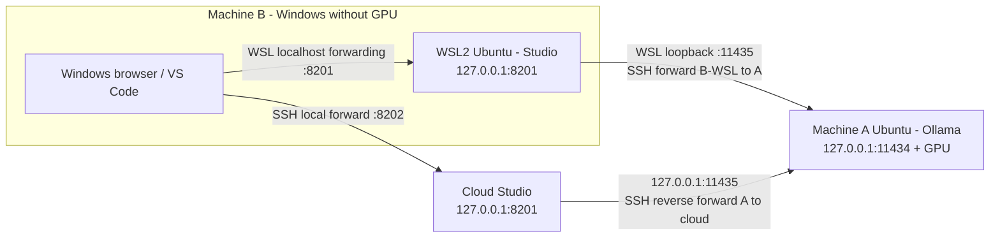

# DevOps Hands-On : Operate VeritasGraph from Home Lab to Cloud

## 1.  outcome and scope

Build a portfolio around **one real application**, rather than unrelated toy examples:

1. Run Ollama on **Machine A: Ubuntu 24.04 with an NVIDIA GPU**.
2. Deploy VeritasGraph Studio on **Machine B: Windows 11 without a GPU, using Ubuntu 24.04 inside WSL2**.
3. Use **the same Windows machine B** for VS Code, SSH, the browser and recording. No third physical workstation is required.
4. Package, automate, monitor, break and recover the deployment.
5. Later deploy a separate Studio instance on a free-tier cloud VM, retaining inference on Machine A.

The commands below are an instructor runbook, not commands executed on your machines.
Use synthetic DevOps documents, not patient records or confidential data.

### Rehearsed workflow

The learner-supplied script covers WSL setup, the local SSH inference tunnel,
native Studio, a switch to Docker, offline backup, Google Cloud SSH and k3s.
The reported cloud checks returned `true` for health and model discovery; its
initial graph was empty. These checks do not yet prove cloud ingest, cited
generation, GPU execution or restore success.
The script contains earlier and later deployment alternatives; choose one
Studio writer per data directory and one listener per host port. Credentials,
personal public keys and unsafe fallback firewall commands are intentionally omitted.

### Deployment source: VeritasGraph repository

| Item | Value |
|---|---|
| GitHub repository | <https://github.com/bibinprathap/VeritasGraph> |
| Local authoring checkout on Windows | `C:\work\VeritasGraph` (same `origin`) |
| Deployment revision | `9bba72c41cfeec701a48107ae60879c756e7babb` (reachable from GitHub branch `restored-main`) |
| Deploy from | A fresh clone inside B-WSL at `~/veritasgraph-/source`, not `/mnt/c/projects/VeritasGraph` |

**Do not deploy the latest GitHub revision yet.** At `68552fd` (`restored-main`, checked 2026-11-11),
`studio_api/main.py` imports `studio_api.security`, `studio_api.netguard`, `studio_api.routes.ontology` and
`studio_api.routes.structured`, but those files are not in Git. Root cause: `.gitignore` line 135 (`studio_api/*`)
silently ignores new files under `studio_api/`. Keep the verified pin until those modules are committed and
the new authentication, SQLite storage and readiness behavior have been rehearsed.
Use this real incident in classes 05 and 14.

Verified on Windows from a clean export of the pinned revision with the minimal dependencies in section 6:
`/health`, `/graphrag/graph` and `/studio` succeeded; `/ready` returned 404. Ollama inference and Linux/WSL
deployment still require rehearsal on the lab machines.

### Related application: not the deployment target

| Source | Actual behavior | Place in this  |
|---|---|---|
| Azure Functions adapter repository | Its query/ingest handlers replace the engine's Ollama call with Azure OpenAI. | Optional Azure/MCP extension; deploying it unchanged does **not** exercise the local GPU. |

If you change the pin, recheck routes, storage, authentication and dependencies before recording.

**Behavior of the pinned revision (corrections to the earlier outline):**

- Studio has `/health`, `/studio`, `/models/`, `/graphrag/graph`, `/graphrag/ingest` and `/graphrag/query`.
- There is **no `/ready` endpoint** and no verified `STUDIO_API_TOKENS` authentication.
- State is `knowledge_graph.json` and `workspace.json` under `STUDIO_DATA_DIR`, **not SQLite**.
- The published `veritasgraph-mcp==0.1.2` package does not include the full Studio routes/UI. Use the full source checkout.
- Some Studio evaluation/fine-tuning flows simulate progression; do not present them as real model training.
- A healthy process does not prove working inference. Test ingest and query as well.

## 2. Lab architecture

| Machine | Suggested resources | Role |
|---|---|---|
| A: `gpu` | Ubuntu 24.04, NVIDIA GPU supported by Ollama, 16+ GB RAM, space for models | Ollama on GPU; SSH server |
| B: `windows-app` | Windows 11, virtualization enabled, 4+ cores, 16+ GB RAM recommended, 60+ GB free SSD; WSL2 Ubuntu 24.04 | Windows: browser, VS Code, recording and SSH. WSL: Studio, Docker Engine, Ansible, Terraform; later single-node k3s lab |
| C: cloud, later | Ubuntu or Debian VM; ARM64 or AMD64; check k3s resource requirements | Separate Studio deployment; no cloud GPU |

Start with a small model such as `qwen3:4b`; confirm available VRAM and output quality before filming.
The original RTX 3090 is sufficient for many quantized small models, but model fit and latency must be measured.
There are **two physical machines only**. WSL is an environment inside B, not another computer.
No GPU, CUDA driver, Ollama installation or local model download is needed on B.



The diagram depicts the original SSH-tunnel cloud path in sections 9.3-9.4;
the protected ngrok alternatives are in sections 9.2 and 9.6.
Only SSH is reachable between machines in the diagram. No router port-forwarding to Studio or Ollama.
The cloud requires outbound connectivity from A to cloud SSH; home CGNAT is normally compatible with this.
Without an authenticated gateway, **do not create a public Studio URL or public Ollama endpoint**.

### Command conventions

- Blocks labelled **Ubuntu, A** run on the physical GPU machine.
- Blocks labelled **B-WSL** run in Ubuntu 24.04 inside Windows Terminal or a VS Code WSL window. B's Linux commands never require bare-metal Ubuntu on the Windows machine.
- Blocks labelled **Windows PowerShell** run on B's Windows side, not inside WSL.
- Linux paths inside Ubuntu commands intentionally use `/`; Windows paths use `\`.
- Use **Docker Engine inside B-WSL**, not Docker Desktop, for the host-network tunnel pattern below. Do not mix the two daemons. WSL GPU support and Windows-native Ollama are not part of this .
- Substitute your own account names for `REPLACE_GPU_USER` and `user` (the WSL account). Service `User=` and `/home/user` refer to the WSL account, not the remote SSH account. Never use a sample password.
- Set `REPLACE_GPU_HOST_LAN_IP` to A's reserved LAN address. Determine B's actual LAN source address before allowing SSH through A's firewall; do not use A's own address as the client allow rule. WSL has its own changing internal address; no fixed WSL IP or inbound WSL SSH is required.
- `REPLACE_...` values are mandatory inputs, never literal deployment values.

## 3. Class list and recording plan

**Format:** 25 classes, each 45-60 minutes including learner practice; approximately 19-25 hours.
Record a 15-25 minute core demonstration per class, with exercises and solutions as separate clips.

Every class follows: **problem -> diagram -> demo -> learner task -> controlled failure -> recovery -> evidence**.
Command references point to the runbook in sections 5-9.

| # | Class and content | Hands-on / command focus | Done when / failure exercise |
|---|---|---|---|
| 01 |  tour, architecture and safety | Two-machine design, hardware inventory, port map; sections 1-2 | Draw Windows -> WSL -> Ubuntu GPU flow; identify which services must remain private. |
| 02 | Install WSL2 and troubleshoot Windows | `wsl --install`, `wsl --status`, firmware virtualization, Virtual Machine Platform, pending reboots, systemd; section 5.0 | Ubuntu-24.04 shows VERSION 2 with systemd as PID 1. Diagnose the real reboot-loop incident in section 5.0.1. |
| 03 | Linux administration | `id`, `ls -l`, `df -h`, `free -h`, `ps`, `systemctl`, `journalctl` | Find a service, its user and listening port; diagnose a permission failure in a disposable directory. |
| 04 | Shell and HTTP troubleshooting | `curl --fail-with-body`, exit codes, `set -euo pipefail`, `jq` | Health script exits nonzero for a bad port, timeout and invalid JSON. |
| 05 | Git and reproducibility | Clone, detached source revision, branch, diff, PR, `git check-ignore -v`; section 6 | Explain why `68552fd` fails: `.gitignore` hid new `studio_api` modules. Commit only lab artifacts; prove data, tokens and `.env` are ignored. |
| 06 | Windows/WSL networking and SSH | Windows vs WSL loopback, NAT, TCP, local/reverse forwarding; sections 5 and 9 | Browser reaches WSL locally; WSL reaches A by SSH; wrong destination port fails visibly. |
| 07 | GPU drivers and local inference | `nvidia-smi`, Ollama install, model pull, generation; section 5 | Observe GPU use during inference; distinguish CPU fallback from GPU execution. |
| 08 | Deploy Studio inside B-WSL without containers | Linux Python environment, configuration, FastAPI; section 6 | Windows browser loads WSL Studio through localhost forwarding. |
| 09 | Prove two-machine inference | Ingest, graph inspection and cited query; section 7 | Graph has nodes/edges and answer cites source; stop only the lab tunnel and diagnose. |
| 10 | Service lifecycle and WSL availability | systemd, startup order, Windows sleep, logs; section 6 | Tunnel returns after restart while WSL runs; explain why Windows sleep/reboot interrupts B. |
| 11 | Docker Engine inside WSL | Dockerfile, image layers, non-root, writable state; section 8 | WSL daemon builds/runs the image; no Docker Desktop or GPU dependency. |
| 12 | Compose and configuration | Host networking on Linux, volumes, healthcheck, environment precedence; section 8 | Restart preserves graph; bad `OLLAMA_HOST` breaks inference even if `/health` passes. |
| 13 | Tests and smoke checks | Source tests, HTTP contracts, meaningful assertions | Test wrong payload, unavailable model and actual response shape; do not treat HTTP 200 alone as success. |
| 14 | CI: test, build and scan | GitHub Actions, clean-checkout import smoke test, focused tests, image build, Trivy, immutable SHA tags | A fresh-clone `import studio_api.main` check fails on `68552fd` and blocks merge; vulnerability policy is explicit. |
| 15 | CD and rollback | Registry credentials, pinned image, approval, smoke gate | Deploy a release and roll back to the previous image without deleting data. |
| 16 | Ansible from B-WSL | Local connection for B-WSL, SSH inventory for A, templates, handlers | Configure lab-scoped resources only; second unchanged run reports zero unexpected changes. |
| 17 | Terraform: understand resources | `init`, `fmt`, `validate`, `plan`, state, quotas | Review a VM plan before apply; no secret values committed in state or variables. |
| 18 | Free-tier cloud foundations | Eligibility, ARM vs AMD64, firewall, SSH, budget; section 9 | Confirm exact free allowances and costs in your own console before provisioning. |
| 19 | Hybrid cloud deployment | Cloud Studio, reverse tunnel or protected ngrok endpoint, image architecture; section 9 | Query on C uses GPU on A; cloud graph is separate from B. |
| 20 | Kubernetes fundamentals | Single-node k3s on cloud VM C, Deployment, Service and probes; section 9.6 | Pod restart preserves state; explicitly explain this is not HA. |
| 21 | Kubernetes state and inference | PVC, one replica, `Recreate`, protected Ollama endpoint, model dependency | No concurrent writers; distinguish pod-network `localhost` from host `localhost`. |
| 22 | GitOps | Argo CD, desired state, approved image updates, secret separation | Reconcile an intentional lab-only drift; prove rollback via Git. |
| 23 | Observability | Prometheus/Grafana, blackbox probes, GPU exporter, logs | Dashboard separates process health, inference failures, GPU use and latency. |
| 24 | Security and recovery | Exposure tests, least privilege, offline backups, restore; section 8 | Restore graph and validate a cited query; no unauthenticated public service. |
| 25 | SRE capstone and incident video | SLO, recovery timer, release, injected failure, postmortem | Rebuild B from code, recover a graph and explain cloud costs and failure domains. |

### Video template for each class

1. **0:00-1:00:** show the outcome and the problem.
2. **1:00-4:00:** explain one diagram; identify host and working directory.
3. **4:00-14:00:** run commands in short groups; explain expected output.
4. **14:00-19:00:** inject one bounded fault and diagnose it.
5. **19:00-23:00:** recover, rerun acceptance checks, show evidence.
6. **Closing:** learner challenge, success criteria, relevant interview questions.

Before recording: enlarge terminal font, label A/B/Windows/C terminals, hide tokens/account details,
disable notifications and rehearse downloads ahead of time. Keep real failures in the troubleshooting clips.

### Exercise repository links

Use the existing material as post-lab review:
[Linux](devops-exercises/topics/linux),
[shell](devops-exercises/topics/shell),
[Git](devops-exercises/topics/git),
[containers](devops-exercises/topics/containers),
[CI/CD](devops-exercises/topics/cicd),
[Ansible](devops-exercises/topics/ansible),
[Terraform](devops-exercises/topics/terraform),
[Kubernetes](devops-exercises/topics/kubernetes),
[Argo](devops-exercises/topics/argo),
[observability](devops-exercises/topics/observability),
[security](devops-exercises/topics/security),
[SRE](devops-exercises/topics/sre).

## 4. Instructor release gates

- **Gate A, classes 1-10:** working native two-machine ingest/query and measured GPU usage.
- **Gate B, classes 11-16:** containerized deployment, tested persistence, CI and Ansible.
- **Gate C, classes 17-19:** cloud eligibility confirmed and hybrid inference demonstrated.
- **Gate D, classes 20-25:** Kubernetes/GitOps artifacts authored and rehearsed; restore and incident drill passed.

Sections 5-9 supply the baseline deployment commands. CI, Ansible, Terraform, Kubernetes,
GitOps and monitoring artifacts are learner deliverables, **not pre-existing files in this folder**.
Do not record an advanced class until its manifests/playbooks/pipeline have passed a rehearsal.

## 5. Prepare Ubuntu A and Windows B

### 5.0 Install WSL2 on Windows B - Windows PowerShell

Baseline: supported, updated Windows 11 with hardware virtualization enabled in firmware.
Run installation commands in **PowerShell as Administrator**:

```powershell
wsl --install -d Ubuntu-24.04
wsl --update
wsl --list --verbose
```

Restart Windows if requested, then open Ubuntu 24.04 and create its Linux user (`lab` in this runbook).

If the distribution already exists, reuse it only after checking that it is suitable for the lab;
do not unregister it or overwrite existing work. Confirm the distribution shows **VERSION 2**.
If it shows version 1, convert the named distribution:

```powershell
wsl --set-version Ubuntu-24.04 2
wsl -d Ubuntu-24.04
```

Inside **B-WSL**, check systemd:

```bash
whoami
ps -p 1 -o comm=
```

Expected PID 1: `systemd`. If it is not, edit `/etc/wsl.conf` with `sudoedit`,
preserving existing settings, and merge:

```ini
[boot]
systemd=true
```

Close work in that distribution, then in **Windows PowerShell**:

```powershell
# Stops processes in this named distribution; save work first.
wsl --terminate Ubuntu-24.04
wsl -d Ubuntu-24.04
```

Recheck PID 1 before using `systemctl`. This  uses default WSL2 NAT networking
and Windows-to-WSL localhost forwarding. If you have customized networking, first review
your existing `%UserProfile%\.wslconfig`; do not overwrite unrelated settings.
For NAT mode, `[wsl2]` supports `localhostForwarding=true` (normally the default).
Changing global WSL settings requires a planned WSL restart and can affect other distributions.

Keep the source, virtual environment and data under **WSL `/home/user/veritasgraph-`**,
not `/mnt/c`, for Linux permissions and filesystem performance.
Open that directory with VS Code's WSL extension; it is separate from the existing Windows source checkout.
Keep an active WSL terminal open during labs. Windows sleep, reboot or WSL termination stops this lab;
systemd enablement is not a promise of an always-on Windows boot service.

#### 5.0.1 Troubleshooting: installer keeps asking for a restart

Real incident from preparing this  on the Windows laptop (Windows 11 Pro, Intel i7-1065G7):
after each restart, `wsl --install -d Ubuntu-24.04` printed
`Installing Windows optional component: VirtualMachinePlatform ... Changes will not be effective until the system is rebooted`
and `wsl --list --verbose` still showed no distributions.

Diagnose before repeating the installer. In **PowerShell as Administrator**:

```powershell
wsl --status
Get-CimInstance Win32_Processor | Format-List Name, VirtualizationFirmwareEnabled
Get-CimInstance Win32_ComputerSystem | Format-List HypervisorPresent
Get-WindowsOptionalFeature -Online -FeatureName VirtualMachinePlatform | Format-List FeatureName, State
Test-Path 'HKLM:\SOFTWARE\Microsoft\Windows\CurrentVersion\Component Based Servicing\RebootPending'
Select-String -Path "$env:windir\Logs\CBS\CBS.log" -Pattern 'pended|ExecuteStateFailed' | Select-Object -Last 10
```

Findings and interpretation:

| Check | Observed | Meaning |
|---|---|---|
| `VirtualizationFirmwareEnabled` | `True` | BIOS/UEFI is not the problem. |
| `HypervisorPresent` | `False` | Windows hypervisor is not running, so WSL2 cannot start. |
| Feature state / reboot pending | `Enabled` / `True` after restarts | The feature change is queued but not committed. |
| CBS log | `CbsExecuteStateFailed`; `package changes need to be pended` | A pending Windows cumulative update blocked the optional-feature transaction. |

Fix: open **Settings -> Windows Update**, choose **Restart now** or **Update and restart**, allow every
update restart to finish, and recheck until no restart is pending. Only then run
`wsl --install -d Ubuntu-24.04` again. Repeating the installer without completing pending servicing only
queues the same change again. If the loop persists, repair Windows servicing as a separate, planned task.
Teaching point: read the system state and logs instead of retrying the same command.

### 5.1 Inventory and basic tools - Ubuntu A and B-WSL

```bash
hostnamectl
lscpu
free -h
df -h
ip -br address
ss -ltnp
sudo apt-get update
sudo apt-get install -y git curl jq ca-certificates openssh-server \
  python3-venv python3-pip ufw
```

On **A only**, enable the SSH server:

```bash
sudo systemctl enable --now ssh
```

B-WSL is an SSH client; it does not need an inbound SSH server.
Review A's firewall before changing it. Do not reset a shared host's firewall.
If enabling UFW on a dedicated A, allow B's actual LAN source before enabling:

```bash
# Default WSL NAT normally reaches A using Windows B's LAN source address.
ADMIN_IP=REPLACE_WINDOWS_IP
sudo ufw allow from "$ADMIN_IP" to any port 22 proto tcp
sudo ufw status verbose
# Only on a dedicated host after confirming the SSH allow rules:
# sudo ufw enable
```

Test SSH from both Windows and B-WSL before closing the original session.
If customized WSL/VPN networking changes the source seen by A, inspect A's SSH/firewall logs
and allow the actual trusted source instead of opening SSH globally.
Do not enable UFW in WSL as if it were the physical host firewall; Windows/Hyper-V
firewall policies are a separate layer. Never open TCP 8201 or 11434 to the Internet.

### 5.2 SSH access - Windows PowerShell

```powershell
Get-Command ssh, ssh-keygen
New-Item -ItemType Directory -Force "$HOME\.ssh" | Out-Null
ssh-keygen -t ed25519 -f "$HOME\.ssh\veritasgraph-lab"
Get-Content "$HOME\.ssh\veritasgraph-lab.pub"
```

Use a passphrase for the workstation key. Add **only its public key** to the Ubuntu user's
`~/.ssh/authorized_keys` on A through your existing trusted login or local console.
Set the remote `.ssh` directory to mode 700 and `authorized_keys` to 600.
Verify host fingerprints against each machine's console, not an unverified `ssh-keyscan`.

```powershell
ssh -i "$HOME/.ssh/veritasgraph-lab" REPLACE_GPU_USER@REPLACE_GPU_HOST_LAN_IP
```

Do not SSH from Windows into its own WSL distribution. Open it with `wsl -d Ubuntu-24.04`.
Windows and WSL have separate home directories, keys and known-hosts files.

### 5.3 NVIDIA and Ollama - Ubuntu, A only

```bash
nvidia-smi
```

If the driver is missing on the dedicated GPU machine:

```bash
sudo apt-get install -y ubuntu-drivers-common
ubuntu-drivers devices
sudo ubuntu-drivers install
# Schedule a reboot; it interrupts this machine.
sudo reboot
```

Reconnect after reboot. Resolve Secure Boot/module-signing issues if `nvidia-smi` still fails.
Do not install GPU drivers on B.

```bash
nvidia-smi
curl -fsSL https://ollama.com/install.sh -o /tmp/veritasgraph-ollama-install.sh
less /tmp/veritasgraph-ollama-install.sh
# Review the downloaded installer before executing it.
sh /tmp/veritasgraph-ollama-install.sh
rm /tmp/veritasgraph-ollama-install.sh
sudo install -d /etc/systemd/system/ollama.service.d
sudo tee /etc/systemd/system/ollama.service.d/lab.conf >/dev/null <<'EOF'
[Service]
Environment="OLLAMA_HOST=127.0.0.1:11434"
EOF
sudo systemctl daemon-reload
sudo systemctl restart ollama
curl --fail-with-body http://127.0.0.1:11434/api/tags
ollama pull qwen3:4b
curl --fail-with-body --max-time 180 http://127.0.0.1:11434/api/generate \
  -H 'Content-Type: application/json' \
  -d '{"model":"qwen3:4b","prompt":"Explain a deployment rollback in one sentence.","stream":false}'
ollama ps
nvidia-smi
journalctl -u ollama -n 50 --no-pager
```

During generation, use `watch -n 1 nvidia-smi` in another A terminal.
Pass: the model is listed, generation returns text, and GPU memory/process activity plus
`ollama ps` confirm GPU use. Save `ollama --version` and `ollama list` for the recording manifest.
Model tags and installer releases can change; record the actual model ID and software version.

### 5.4 Private inference tunnel - B-WSL only

Create a dedicated tunnel key on B. For unattended service operation this key has no passphrase;
restrict its authorized use on A rather than copying the workstation private key.

```bash
install -d -m 700 "$HOME/.ssh"
ssh-keygen -t ed25519 -f "$HOME/.ssh/veritasgraph-gpu" -N ''
cat "$HOME/.ssh/veritasgraph-gpu.pub"
```

On A, append that public key as one line to `~/.ssh/authorized_keys`, prefixed with:

```text
restrict,port-forwarding,permitopen="127.0.0.1:11434" ssh-ed25519 REPLACE_B_PUBLIC_KEY
```

In B-WSL, connect once, verify A's fingerprint, then exit. A shell refusal is acceptable if
you later enforce a forwarding-only account; host-key verification must complete.

```bash
ssh -i "$HOME/.ssh/veritasgraph-gpu" REPLACE_GPU_USER@REPLACE_GPU_HOST_LAN_IP
```

In B-WSL, open a dedicated terminal and keep the tunnel running:

```bash
ssh -NT -i "$HOME/.ssh/veritasgraph-gpu" \
  -o ExitOnForwardFailure=yes -o ServerAliveInterval=30 -o ServerAliveCountMax=3 \
  -L 127.0.0.1:11435:127.0.0.1:11434 REPLACE_GPU_USER@REPLACE_GPU_HOST_LAN_IP
```

In another B-WSL terminal:

```bash
curl --fail-with-body http://127.0.0.1:11435/api/tags | jq .
```

Pass: the result contains the chat model you will use. The supplied script uses
`glm-4.7-flash:latest`; `qwen3:4b` remains a smaller optional model, not an assumed
installed model. Port 11435 is loopback-only on B; Ollama remains loopback-only on A.

If SSH times out, check from B-WSL before changing keys or services:

```bash
ip route get REPLACE_GPU_HOST_LAN_IP
nc -vz -w 5 REPLACE_GPU_HOST_LAN_IP 22
```

Install `netcat-openbsd` if `nc` is missing. A TCP timeout occurs before SSH
authentication. Verify A's address, SSH listener, routing and client-specific
firewall rules; do not delete broad firewall rules or invent a Tailscale address.

## 6. Deploy Studio in the Linux environment - B-WSL

Use a **new lab checkout inside WSL**, not `C:\work\VeritasGraph` through `/mnt/c` or a live application directory.
Edit and commit in the Windows checkout if you wish, push to GitHub, then deploy by revision from the WSL clone.
Here "native" means a Linux Python process in WSL, not Windows-native Python.

```bash
mkdir -p "$HOME/veritasgraph-"
cd "$HOME/veritasgraph-"
git clone https://github.com/bibinprathap/VeritasGraph.git source
cd source
git merge-base --is-ancestor 9bba72c41cfeec701a48107ae60879c756e7babb origin/restored-main
git checkout --detach 9bba72c41cfeec701a48107ae60879c756e7babb
git rev-parse HEAD
sudo apt-get update
sudo apt-get install -y python3.12-venv jq
python3 -m venv ../venv
../venv/bin/python -m pip install \
  'fastapi>=0.110,<1' 'uvicorn>=0.29,<1' 'httpx>=0.27,<1' 'pydantic>=2.5,<3'
../venv/bin/python -m pip freeze > ../requirements.studio.lock.txt
mkdir -p ../data-native
../venv/bin/python -c "import fastapi, uvicorn, httpx, pydantic; print('Studio dependencies OK')"
export STUDIO_DATA_DIR="$HOME/veritasgraph-/data-native"
export OLLAMA_HOST=http://127.0.0.1:11435
../venv/bin/python -m uvicorn studio_api.main:app \
  --host 127.0.0.1 --port 8201 --workers 1
```

These are the inspected Studio's minimal web dependencies, not all optional research tooling.
After a successful rehearsal, preserve the generated lock file in the  repository;
rebuild future environments from that lock. Full dependency locking with hashes is an advanced exercise.
Do not use the MCP adapter's two-line requirements file as a full Studio install.

Keep the process in the foreground for the first demonstration.
In another B-WSL terminal:

```bash
curl --fail-with-body http://127.0.0.1:8201/health | jq -e '.status == "ok"'
curl --fail-with-body http://127.0.0.1:8201/models/ | jq .
curl --fail-with-body http://127.0.0.1:8201/graphrag/graph | jq .
```

### Browser access from the same Windows B - Windows PowerShell

```powershell
Invoke-RestMethod -Uri "http://127.0.0.1:8201/health"
Start-Process "http://127.0.0.1:8201/studio"
```

WSL localhost forwarding provides browser access; **no Windows-to-B SSH tunnel is needed**.
Keep WSL and its inference tunnel running.
If Windows cannot connect, first run the section 6 health check inside WSL.
Then check the distribution state with `wsl --list --verbose`, localhost-forwarding settings,
Windows/Hyper-V firewall policy and port conflicts:

```powershell
Get-NetTCPConnection -LocalPort 8201 -ErrorAction SilentlyContinue
```

Do not solve localhost failures by publishing Studio on all interfaces.
If port 8201 conflicts with an existing application, choose another unused port and update
the app command, container CMD, healthcheck, smoke tests and browser URL consistently.

### Make the B-WSL-to-A tunnel persistent - B-WSL

Stop only the foreground inference tunnel with Ctrl+C before starting this service.
Create a system service running as the existing WSL `user` account:

```bash
sudo tee /etc/systemd/system/veritasgraph-inference-tunnel.service >/dev/null <<'EOF'
[Unit]
Description=VeritasGraph lab SSH tunnel to GPU host
Wants=network-online.target
After=network-online.target

[Service]
User=user
ExecStart=/usr/bin/ssh -NT -i /home/user/.ssh/veritasgraph-gpu -o BatchMode=yes -o StrictHostKeyChecking=yes -o ConnectTimeout=10 -o ExitOnForwardFailure=yes -o ServerAliveInterval=30 -o ServerAliveCountMax=3 -L 127.0.0.1:11435:127.0.0.1:11434 REPLACE_GPU_USER@REPLACE_GPU_HOST_LAN_IP
Restart=always
RestartSec=5
NoNewPrivileges=true

[Install]
WantedBy=multi-user.target
EOF
sudo systemctl daemon-reload
sudo systemctl enable --now veritasgraph-inference-tunnel
systemctl status veritasgraph-inference-tunnel --no-pager
curl --fail-with-body http://127.0.0.1:11435/api/tags
sudo ss -ltnp 'sport = :11435'
```

Verify that the port's SSH PID matches the service's `MainPID`. A successful
curl may come from an older foreground tunnel even while systemd is failing.
`217/USER` indicates a local service-account problem; `Address already in use`
means another listener owns the port.

### Run native Studio as a service - B-WSL

Stop foreground Studio with Ctrl+C first. If Docker Studio is running, stop
only that container from its Compose directory before starting native Studio:

```bash
cd "$HOME/veritasgraph-"
sudo docker compose stop studio
```

Skip that command if no Compose deployment exists. Native Studio uses
`data-native`, not Docker's `data-container`.

```bash
sudo tee /etc/systemd/system/veritasgraph-studio.service >/dev/null <<'EOF'
[Unit]
Description=VeritasGraph Studio
Wants=veritasgraph-inference-tunnel.service
After=veritasgraph-inference-tunnel.service

[Service]
Type=exec
User=user
WorkingDirectory=/home/user/veritasgraph-/source
Environment=OLLAMA_HOST=http://127.0.0.1:11435
Environment=STUDIO_DATA_DIR=/home/user/veritasgraph-/data-native
ExecStart=/home/user/veritasgraph-/venv/bin/python -m uvicorn studio_api.main:app --host 127.0.0.1 --port 8201 --workers 1
Restart=on-failure
RestartSec=5
NoNewPrivileges=true

[Install]
WantedBy=multi-user.target
EOF
sudo systemctl daemon-reload
sudo systemctl enable veritasgraph-studio
sudo systemctl restart veritasgraph-studio
systemctl status veritasgraph-studio --no-pager
curl -fsS --retry 5 --retry-connrefused --max-time 10 http://127.0.0.1:8201/models/ | jq .
```

Do not run native Studio and container Studio on port 8201 simultaneously. For
a conflict, inspect before stopping anything:

```bash
sudo journalctl -u veritasgraph-studio -n 50 --no-pager
sudo ss -ltnp 'sport = :8201'
```

These units run only while the WSL environment is running. After Windows reboot, start
Ubuntu 24.04, keep a WSL terminal active and verify the tunnel, Docker and Studio before recording.
Document Windows power/sleep policy as part of the availability lesson; B is not an always-on server.

### Optional: use ngrok instead of the local inference tunnel

First verify the trusted, access-controlled gateway. Then change the native unit's
`Wants=` and `After=` to `network-online.target` and its `OLLAMA_HOST` to
`http://127.0.0.1:11435`. Check `systemctl cat veritasgraph-studio`
for an existing `ollama.conf` drop-in: its environment setting overrides the unit.
Update that setting too if necessary. Only then disable the unused inference
tunnel and reload/restart Studio:

```bash
curl -fsS --max-time 10 http://127.0.0.1:11435/api/tags | jq .
# After updating the unit and any overriding drop-in:
sudo systemctl disable --now veritasgraph-inference-tunnel
sudo systemctl daemon-reload
sudo systemctl restart veritasgraph-studio
curl -fsS --retry 5 --retry-connrefused --max-time 10 http://127.0.0.1:8201/models/ | jq .
```

For Docker, change `OLLAMA_HOST` in Compose instead and recreate the container;
changing a systemd unit does not change a running container's environment.
The SSH-only acceptance fixture below applies to the tunnel path; use the
ngrok/cloud fixture in section 9.6.4 for that architecture instead.

## 7. Acceptance test: real graph and GPU inference - B-WSL

Run this against the native deployment first, then repeat against the container deployment.
The model must already be pulled on A. The fixture is synthetic and safe to show in a video.

```bash
set -euo pipefail
BASE=http://127.0.0.1:8201
curl --fail-with-body --max-time 240 "$BASE/graphrag/ingest" \
  -H 'Content-Type: application/json' \
  -d '{"title":"DevOps release runbook","text":"VeritasGraph Studio runs on Machine B. Studio calls Ollama on Machine A through an SSH tunnel. Machine A uses an NVIDIA GPU for inference. If the SSH tunnel fails, restore the tunnel before retrying inference.","model":"glm-4.7-flash:latest"}' \
  -o /tmp/veritasgraph-ingest.json
jq -e '.message == "Document ingested" and (.result | type == "object")' \
  /tmp/veritasgraph-ingest.json
curl --fail-with-body "$BASE/graphrag/graph" -o /tmp/veritasgraph-graph.json
jq -e '(.nodes | length) > 0 and (.edges | length) > 0' /tmp/veritasgraph-graph.json
curl --fail-with-body --max-time 240 "$BASE/graphrag/query" \
  -H 'Content-Type: application/json' \
  -d '{"question":"Why does Studio need the SSH tunnel to answer questions?","model":"glm-4.7-flash:latest","max_depth":2,"max_nodes":25}' \
  -o /tmp/veritasgraph-answer.json
jq . /tmp/veritasgraph-answer.json
jq -e '
  . as $r |
  ($r.answer | type == "string" and length > 0) and
  ($r.reasoning_path | length > 0) and
  ($r.citations | length > 0) and
  any($r.citations[]; .id as $id | $r.answer | contains("[" + $id + "]"))
' /tmp/veritasgraph-answer.json
```

The assertion checks the inspected response fields and an inline citation matching a returned source.
The engine can return retrieved sources even when the answer has no citations, so a nonempty
`citations` array alone is insufficient. Also review the answer against the source text.
Pass only when the answer is nonempty, relevant and cites a source from the ingested document;
also observe GPU activity on A. An empty graph, fallback answer or HTTP 200 containing an error does not pass.
Model output is nondeterministic: if extraction fails, preserve the response and diagnose it rather than faking success.
Remove the three specifically named `/tmp/veritasgraph-*.json` files after collecting evidence.

**Failure video:** stop only B's lab tunnel service, retry the same query and capture the error.
`/health` can still return OK. Restart the service and repeat the query successfully.
Do not stop shared Ollama or disrupt other applications for a demonstration.

## 8. Container deployment, operations and recovery - B-WSL

### 8.1 Install Docker Engine inside B-WSL

Use the Ubuntu-packaged Docker Engine **inside this WSL distribution**.
If a Linux Docker Engine already exists there, keep it and confirm Compose support.
If Docker Desktop integration is active for this distribution, disable that integration and
stop its use for these labs before installing the WSL-local engine. Do not point the CLI
at a Desktop or remote daemon: the container must share B-WSL's network namespace for the tunnel.

```bash
sudo apt-get update
sudo apt-get install -y docker.io docker-compose-v2
sudo systemctl enable --now docker
sudo docker version
sudo docker compose version
sudo docker context show
sudo docker info --format '{{.Name}} / {{.OperatingSystem}}'
```

Confirm the daemon is the local Ubuntu/WSL engine, not Docker Desktop.
If systemd is unavailable, complete section 5.0 instead of bypassing service startup.

### 8.2 Create the image and Compose definition

Keep the Ollama inference tunnel running. Build the image before stopping the
native Studio so a failed build does not take Studio offline.
The following `cat` blocks are **Ubuntu learner commands** for creating  artifacts.

```bash
cd "$HOME/veritasgraph-"
cat > Dockerfile <<'EOF'
FROM python:3.12-slim
ENV PYTHONDONTWRITEBYTECODE=1 PYTHONUNBUFFERED=1
WORKDIR /app
COPY requirements.studio.lock.txt /tmp/requirements.studio.lock.txt
RUN python -m pip install --no-cache-dir -r /tmp/requirements.studio.lock.txt \
    && groupadd --gid 10001 studio \
    && useradd --uid 10001 --gid studio --no-create-home studio
COPY source/studio_api /app/studio_api
COPY source/veritasgraph_mcp /app/veritasgraph_mcp
COPY source/demos/agent-studio /app/demos/agent-studio
USER 10001:10001
CMD ["python", "-m", "uvicorn", "studio_api.main:app", "--host", "127.0.0.1", "--port", "8201", "--workers", "1"]
EOF
cat > .dockerignore <<'EOF'
*
!Dockerfile
!requirements.studio.lock.txt
!source/
source/*
!source/studio_api/
!source/veritasgraph_mcp/
!source/demos/
source/demos/*
!source/demos/agent-studio/
**/__pycache__/
source/studio_api/data/
EOF
sudo install -d -o 10001 -g 10001 -m 750 data-container
cat > compose.yaml <<'EOF'
services:
  studio:
    image: veritasgraph-studio:lab
    build:
      context: .
    network_mode: host
    environment:
      STUDIO_DATA_DIR: /data
      OLLAMA_HOST: http://127.0.0.1:11435
    volumes:
      - ./data-container:/data
    read_only: true
    tmpfs:
      - /tmp:size=64m,mode=1777
    cap_drop:
      - ALL
    security_opt:
      - no-new-privileges:true
    restart: unless-stopped
    healthcheck:
      test: ["CMD", "python", "-c", "import urllib.request; urllib.request.urlopen('http://127.0.0.1:8201/health', timeout=3)"]
      interval: 15s
      timeout: 5s
      retries: 3
      start_period: 20s
EOF
sudo docker compose config --quiet
sudo docker compose build studio
```

Once the build succeeds, stop the native foreground Studio with Ctrl+C, or run
`sudo systemctl disable --now veritasgraph-studio` if you installed the native
systemd unit. This prevents the native instance from reclaiming port 8201 on a
later WSL boot. Do not start the container if stopping native Studio fails.
Then start the container and verify model discovery:

```bash
sudo docker compose up -d --no-build --wait --wait-timeout 60 studio
sudo docker compose ps
sudo docker compose logs --tail=80 studio
curl --fail-with-body http://127.0.0.1:8201/health
curl --fail-with-body http://127.0.0.1:8201/models/ \
  | jq -e '.source == "ollama-http" and .count > 0'
```

Repeat **all section 7 tests**, using the new empty container data directory.
Native and container datasets are intentionally separate.
Linux host networking with the **WSL-local Docker Engine** lets the container reach
the SSH tunnel on WSL loopback without opening Ollama to a bridge subnet.
It sacrifices network-namespace isolation; this is a deliberate teaching trade-off, not the default for every application.
No `ports:` entry is needed. Windows reaches the WSL loopback listener through localhost forwarding.
This is a Windows + WSL-local Linux Engine recipe, **not** a Docker Desktop or Windows-container recipe.

Before recording a release, pin the base image digest and freeze all dependency versions from the successful build.
For ARM cloud machines, rebuild on ARM or publish a tested multi-architecture image; do not assume an AMD64-only image works.

### 8.3 Operational commands

```bash
cd "$HOME/veritasgraph-"
sudo docker compose ps
sudo docker compose logs --tail=100 studio
sudo docker compose restart studio
curl --fail-with-body http://127.0.0.1:8201/health
ss -ltn | grep -E ':(8201|11435)\b'
```

Pass: Studio and the tunnel listen only on loopback.
From A, a direct connection to Windows B's LAN IP on port 8201 must fail.
From B-WSL, a direct connection to A's LAN IP on port 11434 must fail.
Use these existing two machines for the exposure tests; no third computer is required.
check listeners/firewall rather than assuming a timeout proves correct configuration.
Docker-published ports can bypass ordinary UFW expectations in other networking modes.

### 8.4 Consistent offline backup and restore

This revision persists multiple JSON files. Stop its only writer before archiving the data directory.
There is no SQLite backup API in this revision.

```bash
cd "$HOME/veritasgraph-"

(
  set -euo pipefail

  mkdir -p -m 700 backups
  chmod 700 backups
  test -d data-container
  sudo -v

  partial=$(mktemp "backups/.studio-$(date -u +%Y%m%dT%H%M%SZ)-XXXXXX.partial")
  backup="${partial%.partial}.tgz"

  restart_studio() {
    status=$?
    trap - EXIT
    if ! sudo docker compose start studio; then
      echo "ERROR: Studio did not restart; check docker compose logs." >&2
      status=1
    fi
    exit "$status"
  }
  trap restart_studio EXIT
  trap 'exit 130' INT
  trap 'exit 143' TERM

  sudo docker compose stop studio
  sudo tar -czf "$partial" -C data-container .
  sudo tar -tzf "$partial" >/dev/null
  mv "$partial" "$backup"
  sha256sum "$backup" > "$backup.sha256"

  echo "Backup: $backup"
  echo "Checksum: $backup.sha256"
)

sudo docker compose ps
curl -fsS --max-time 10 http://127.0.0.1:8201/health
```

The EXIT trap attempts to restart Studio on failure as well as success.
If the archive command fails, the `.partial` file is not a completed backup.
If restart fails, surface the error and restart Studio explicitly; do not claim a successful backup.
For a **restore drill**, preserve the original directory and extract into a fresh one:

```bash
# Set this to a known completed backup, not an unreviewed wildcard.
BACKUP=backups/REPLACE_COMPLETED_BACKUP.tgz
(
  set -euo pipefail
  test -f "$BACKUP"
  sha256sum -c "$BACKUP.sha256"
  test -d data-container
  test ! -e data-before-restore
  test ! -e data-restored
  sudo mkdir -m 750 data-restored
  sudo tar -xzf "$BACKUP" -C data-restored
  sudo chown -R 10001:10001 data-restored
  sudo docker compose stop studio
  sudo mv data-container data-before-restore
  sudo mv data-restored data-container
  sudo docker compose up -d --force-recreate --wait --wait-timeout 60 studio
)
```

Stop if the subshell fails. If a move fails after stopping Studio, inspect
the actual directories before attempting rollback; do not blindly repeat moves
or start against an accidentally empty directory. After a successful restore:

```bash
curl --fail-with-body http://127.0.0.1:8201/graphrag/graph | jq .
```

Run these checks individually and stop at any failure.
Compare graph counts with pre-backup evidence and repeat the cited query **without re-ingesting**.
Keep `data-before-restore` until the drill passes. A container restart alone does not demonstrate recovery.
Never use broad deletion or `docker system prune` as a classroom cleanup shortcut.

## 9. Later: free-tier cloud extension

Section 9.2 includes the Google Cloud native service with ngrok; sections 9.3-9.4
retain the original direct-SSH cloud path as an alternative. Section 9.6 adds
Google Cloud VM + k3s using the protected ngrok Ollama endpoint. Do not combine
their inference tunnels or assume any path automatically copies local data.

### 9.1 Recommendation and cost boundaries

**First choice: Oracle Cloud Always Free Ampere A1**, if available and your account is eligible.
Its RAM allocation is more suitable than a 1 GB micro VM for this small Studio deployment.
**Do not depend on getting capacity**, and do not promise a permanently free production service.

Official pages checked while preparing this outline:

- [Oracle Always Free resource limits](https://docs.oracle.com/en-us/iaas/Content/FreeTier/freetier_topic-Always_Free_Resources.htm):
  the retrieved page lists **1,500 OCPU-hours and 9,000 GB-hours/month**, equivalent to
  **2 OCPUs and 12 GB RAM**, with 200 GB aggregate block storage. Old tutorials often quote different limits.
  Treat the current console/terms for your account as authoritative; verify before creating anything.
- [Oracle Free Tier](https://www.oracle.com/cloud/free/): limited trial credit is separate from Always Free;
  capacity shortages and idle-instance reclamation are possible.
- [Google Cloud Free Tier](https://cloud.google.com/free/docs/free-cloud-features):
  alternative eligible e2-micro compute has region/usage limits; trial credit expires.
  Public IPv4, networking, disks and other services must be priced separately.

Cloud GPUs are **not included in this baseline**. Model inference still costs local electricity.
Budget alerts are notifications, not a hard spending cap.

Before creating C:

1. Confirm eligibility, billing status, current allowances and ARM Ubuntu image availability.
2. Choose one Always Free-labelled A1 instance, conservatively 1 OCPU / 6 GB if eligible.
3. Count all boot/block volumes against the tenancy-wide free storage allowance.
4. Configure budget notifications and service/compartment quotas where supported.
5. Allow inbound SSH only from your workstation and GPU host's actual public source addresses.
6. If those addresses change, update the rules or use a properly configured private access solution.
7. Leave 8201, 11434 and 11435 closed in both cloud security rules and host firewall.
8. Avoid managed Kubernetes, load balancers, NAT gateways, paid monitoring tiers and extra disks.

Provisioning is console-guided for the first class because image IDs, compartments, regions and
availability domains are account-specific. The Terraform class encodes those verified inputs later.
If free capacity is unavailable, use a **time-limited credit-backed CPU VM** with an explicit teardown date,
or repeat the deployment exercise in an isolated local VM on B if its resources allow.
That VM is optional, not a third physical machine, and is not an unconditional free-cloud guarantee.

### 9.2 Prepare C

For the Google Cloud Debian VM in the supplied script, use the following native
deployment first, or skip directly to section 9.6 for k3s. These are separate
datasets. In **B-WSL**, install the
[Google Cloud CLI](https://cloud.google.com/sdk/docs/install) if needed:

```bash
gcloud auth login
gcloud config set project REPLACE_GCP_PROJECT_ID
gcloud compute ssh REPLACE_GCP_USER@REPLACE_GCP_INSTANCE \
  --zone=REPLACE_GCP_ZONE --tunnel-through-iap
```

IAP requires appropriate IAM permissions and SSH firewall access from IAP;
OS Login may assign a different username. On **C**, use a fresh directory:

```bash
whoami
uname -m
sudo apt-get update
sudo apt-get install -y git python3-venv python3-pip curl jq
curl -fsS --max-time 10 http://127.0.0.1:11435/api/tags | jq .
mkdir -p "$HOME/veritasgraph-"
cd "$HOME/veritasgraph-"
git clone https://github.com/bibinprathap/VeritasGraph.git source
cd source
git checkout --detach 9bba72c41cfeec701a48107ae60879c756e7babb
python3 -m venv ../venv
../venv/bin/python -m pip install \
  'fastapi>=0.110,<1' 'uvicorn>=0.29,<1' 'httpx>=0.27,<1' 'pydantic>=2.5,<3'
../venv/bin/python -m pip freeze > ../requirements.studio.lock.txt
mkdir -p ../data-native
sudo tee /etc/systemd/system/veritasgraph-studio.service >/dev/null <<EOF
[Unit]
Description=VeritasGraph Cloud Studio
After=network-online.target
Wants=network-online.target

[Service]
User=$(id -un)
WorkingDirectory=$HOME/veritasgraph-/source
Environment=OLLAMA_HOST=http://127.0.0.1:11435
Environment=STUDIO_DATA_DIR=$HOME/veritasgraph-/data-native
ExecStart=$HOME/veritasgraph-/venv/bin/python -m uvicorn studio_api.main:app --host 127.0.0.1 --port 8201 --workers 1
Restart=on-failure
RestartSec=5
NoNewPrivileges=true

[Install]
WantedBy=multi-user.target
EOF
sudo systemctl daemon-reload
sudo systemctl enable veritasgraph-studio
sudo systemctl restart veritasgraph-studio
systemctl status veritasgraph-studio --no-pager
curl -fsS --retry 5 --retry-connrefused --max-time 10 http://127.0.0.1:8201/health | jq .
curl -fsS --max-time 15 http://127.0.0.1:8201/models/ | jq .
```

The same protected-gateway requirements as section 9.6 apply. Do not add a
reverse SSH tunnel when using ngrok. For the native cloud UI, leave this command
running in a separate **B-WSL** terminal:

```bash
gcloud compute ssh REPLACE_GCP_USER@REPLACE_GCP_INSTANCE \
  --zone=REPLACE_GCP_ZONE --tunnel-through-iap -- \
  -NT -o ExitOnForwardFailure=yes \
  -o ServerAliveInterval=30 -o ServerAliveCountMax=3 \
  -L 127.0.0.1:8202:127.0.0.1:8201
```

Open `http://127.0.0.1:8202/studio` in Windows. Stop this UI tunnel before
starting the k3s UI tunnel in section 9.6.4, which uses the same local `8202`
but targets C's `8203`.

**Alternative: original Ubuntu/direct-SSH path (sections 9.3-9.4).**
Skip the rest of this subsection and sections 9.3-9.4 for the ngrok/IAP path.
Choose Ubuntu 24.04. Cloud images may use `ubuntu`, not `lab`.
From Windows, verify the host fingerprint using trusted cloud console information:

```powershell
ssh -i "$HOME\.ssh\veritasgraph-cloud" ubuntu@REPLACE_CLOUD_PUBLIC_IP
```

Create that workstation key first, and supply its public key during VM provisioning.
On C, use section 5.1's Ubuntu package installation and enable its SSH server, then
use section 8.1's Docker Engine installation commands. C is a real Ubuntu cloud VM:
skip WSL installation, Windows localhost-forwarding and Docker Desktop instructions.
Clone and install the source using section 6's Bash commands in C's home directory.
Generate the lock on C or use a release lock tested for its architecture.
Build and run section 8 on C, substituting C's home directory.
Cloud Studio can start before inference is available, but inference acceptance must not pass yet.

### 9.3 Connect A to C without opening home inbound ports

On A create a separate dedicated key:

```bash
ssh-keygen -t ed25519 -f "$HOME/.ssh/veritasgraph-cloud-tunnel" -N ''
cat "$HOME/.ssh/veritasgraph-cloud-tunnel.pub"
```

On C, add that public key to the target user's `authorized_keys` with:

```text
restrict,port-forwarding,permitlisten="127.0.0.1:11435" ssh-ed25519 REPLACE_A_PUBLIC_KEY
```

Keep SSH `GatewayPorts no` on C. Verify the effective SSH configuration before recording.
On A, establish trust in C's host key, then keep this command running in a dedicated terminal:

```bash
ssh -NT -i "$HOME/.ssh/veritasgraph-cloud-tunnel" \
  -o StrictHostKeyChecking=yes -o ExitOnForwardFailure=yes \
  -o ServerAliveInterval=30 -o ServerAliveCountMax=3 \
  -R 127.0.0.1:11435:127.0.0.1:11434 ubuntu@REPLACE_CLOUD_PUBLIC_IP
```

On C:

```bash
curl --fail-with-body http://127.0.0.1:11435/api/tags | jq .
ss -ltn | grep -E ':(8201|11435)\b'
```

For persistent operation, adapt section 6's tunnel systemd unit **on A**, using A's actual user/key,
the cloud destination and `-R` instead of `-L`. Never run the foreground tunnel and its service on the same port together.
Test a reboot and reconnect before calling it reliable.

### 9.4 Open the cloud UI privately - Windows PowerShell

```powershell
ssh -NT -i "$HOME\.ssh\veritasgraph-cloud" `
  -o ExitOnForwardFailure=yes `
  -L 127.0.0.1:8202:127.0.0.1:8201 ubuntu@REPLACE_CLOUD_PUBLIC_IP
```

Browse to `http://127.0.0.1:8202/studio`.
Run section 7 on C and observe GPU activity on A.
Cloud and local graphs are separate: this is a second deployment, **not** automatic data replication or failover.

Failure exercise: close A's reverse tunnel. Show that cloud `/health` succeeds but inference fails,
then restore connectivity. Explain that home power, Internet and the GPU remain single points of failure.

### 9.5 End the cloud lab safely

Back up wanted state and export the resource inventory first. Review each named resource before deletion.
Stop the dedicated reverse-tunnel service on A. Terminate only the  VM and explicitly review
retained boot volumes, reserved addresses and other associated resources.
If managed by Terraform, inspect `terraform plan -destroy` before an approved `terraform destroy`.
Check billing and resource inventory afterwards; stopped VMs can retain chargeable resources.

### 9.6 Google Cloud VM + k3s, controlled from laptop WSL

This alternative runs a **single-node** k3s cluster on C, not in WSL. B-WSL
provides `gcloud` and an IAP SSH tunnel; the Windows browser uses that tunnel.
Studio in the pod calls Ollama on A through
`http://127.0.0.1:11435`. No SSH reverse tunnel to Ollama is used.
The ngrok gateway must be trusted, access-controlled and able to forward Ollama
`/api/tags` and `/api/chat` requests. The pinned Studio has no configuration here
for custom authentication headers: if the gateway requires them, do not bypass
authentication; configure a separately secured compatible gateway first.
Avoid confidential documents and prompts. Do not expose Studio, Ollama or the
Kubernetes API publicly.

The cloud PVC is a new, empty dataset; B's native and Docker datasets are not
copied. One node, one pod and local disk are not HA or failover. A stopped
laptop closes browser access, but does not stop the VM or its charges.

#### 9.6.1 Check and connect - B-WSL

Before running the examples, set `REPLACE_GCP_INSTANCE`, `REPLACE_GCP_ZONE`,
`REPLACE_GCP_PROJECT_ID` and `REPLACE_GCP_USER` to values for your own Debian VM
and cloud account. Install the
[Google Cloud CLI](https://cloud.google.com/sdk/docs/install) in WSL if needed.
IAP requires appropriate IAM permissions and an ingress rule allowing IAP to
reach VM SSH, as described in the
[IAP SSH documentation](https://docs.cloud.google.com/compute/docs/connect/ssh-using-iap).
OS Login may assign a different username.

```bash
gcloud auth login
gcloud config set project REPLACE_GCP_PROJECT_ID
gcloud compute ssh REPLACE_GCP_USER@REPLACE_GCP_INSTANCE \
  --zone=REPLACE_GCP_ZONE --tunnel-through-iap
```

The following blocks, through 9.6.4, run **on C in the SSH session**.
Check available resources and billing before installing anything:

```bash
whoami
uname -m
nproc
free -h
df -h "$HOME"
curl -fsS --max-time 10 http://127.0.0.1:11435/api/tags | jq .
```

Install `jq` first if it is missing (`sudo apt-get update && sudo apt-get install -y jq`).
The k3s server minimum is 2 CPU cores and 2 GB RAM; the application and image build
need additional resources. A free-tier micro VM may be insufficient. Check the
[current k3s requirements](https://docs.k3s.io/installation/requirements) and
your VM pricing; do not resize or install on a shared VM without approval.

#### 9.6.2 Install k3s and build the Studio image - C

Use an isolated lab VM. Do not rerun the installer on an existing k3s cluster:
it can change its configuration. Review the installer before running it; record
the installed version and pin a tested version for a reproducible release.
The Debian packages below also install Docker for the image build only; k3s runs
the pod using its own containerd.

```bash
sudo apt-get update
sudo apt-get install -y curl git jq python3-venv docker.io
sudo systemctl enable --now docker
curl -fsSL https://get.k3s.io -o /tmp/veritasgraph-k3s-install.sh
less /tmp/veritasgraph-k3s-install.sh
# After review, on a fresh lab VM only:
sudo env INSTALL_K3S_EXEC='server --disable traefik' sh /tmp/veritasgraph-k3s-install.sh
sudo systemctl status k3s --no-pager
sudo k3s kubectl get nodes
sudo k3s kubectl get storageclass
```

Wait for the node to be `Ready` and confirm `local-path` storage is available.
If either check fails, diagnose it before proceeding. Keep the k3s kubeconfig
private: it grants cluster administrator access.

The following uses a new directory so it does not overwrite a previous native or
Compose cloud deployment. Stop if the directory already exists; inspect it first.
The generated dependency lock is a first-run snapshot, not a fully reproducible
hash-locked release.

```bash
mkdir "$HOME/veritasgraph-k3s-"
cd "$HOME/veritasgraph-k3s-"
git clone https://github.com/bibinprathap/VeritasGraph.git source
cd source
git checkout --detach 9bba72c41cfeec701a48107ae60879c756e7babb
git rev-parse HEAD
python3 -m venv ../venv
../venv/bin/python -m pip install \
  'fastapi>=0.110,<1' 'uvicorn>=0.29,<1' 'httpx>=0.27,<1' 'pydantic>=2.5,<3'
../venv/bin/python -m pip freeze > ../requirements.studio.lock.txt
cd ..
cat > Dockerfile <<'EOF'
FROM python:3.12-slim
ENV PYTHONDONTWRITEBYTECODE=1 PYTHONUNBUFFERED=1
WORKDIR /app
COPY requirements.studio.lock.txt /tmp/requirements.studio.lock.txt
RUN python -m pip install --no-cache-dir -r /tmp/requirements.studio.lock.txt \
    && groupadd --gid 10001 studio \
    && useradd --uid 10001 --gid studio --no-create-home studio
COPY source/studio_api /app/studio_api
COPY source/veritasgraph_mcp /app/veritasgraph_mcp
COPY source/demos/agent-studio /app/demos/agent-studio
USER 10001:10001
CMD ["python", "-m", "uvicorn", "studio_api.main:app", "--host", "0.0.0.0", "--port", "8201", "--workers", "1"]
EOF
cat > .dockerignore <<'EOF'
*
!Dockerfile
!requirements.studio.lock.txt
!source/
source/*
!source/studio_api/
!source/veritasgraph_mcp/
!source/demos/
source/demos/*
!source/demos/agent-studio/
**/__pycache__/
source/studio_api/data/
EOF
set -o pipefail
sudo docker build -t docker.io/library/veritasgraph-studio:k3s-lab .
sudo docker image save docker.io/library/veritasgraph-studio:k3s-lab \
  | sudo k3s ctr images import -
sudo k3s ctr images list | grep 'veritasgraph-studio'
```

Build for the VM's actual architecture. The image is imported only into this
single node; it is not published to a registry. `pipefail` ensures a failed
image save is not masked by the import command.
Never proceed after a failed build or import.

#### 9.6.3 Deploy a private Studio service - C

The `ClusterIP` service has no public IP, NodePort or ingress. The pod needs
`0.0.0.0` inside its network namespace; this does not itself publish a host port.
The local-path PVC survives pod replacement on this node, not VM loss. Its
requested size is not necessarily a filesystem quota. Keep one replica and the
`Recreate` strategy because the JSON files have one writer.

```bash
cd "$HOME/veritasgraph-k3s-"
cat > studio-k8s.yaml <<'EOF'
apiVersion: v1
kind: Namespace
metadata:
  name: veritasgraph-lab
---
apiVersion: v1
kind: PersistentVolumeClaim
metadata:
  name: studio-data
  namespace: veritasgraph-lab
spec:
  accessModes: [ReadWriteOnce]
  storageClassName: local-path
  resources:
    requests:
      storage: 2Gi
---
apiVersion: apps/v1
kind: Deployment
metadata:
  name: studio
  namespace: veritasgraph-lab
spec:
  replicas: 1
  strategy:
    type: Recreate
  selector:
    matchLabels:
      app: studio
  template:
    metadata:
      labels:
        app: studio
    spec:
      securityContext:
        runAsNonRoot: true
        runAsUser: 10001
        runAsGroup: 10001
        fsGroup: 10001
      containers:
        - name: studio
          image: docker.io/library/veritasgraph-studio:k3s-lab
          imagePullPolicy: Never
          ports:
            - containerPort: 8201
          env:
            - name: OLLAMA_HOST
              value: http://127.0.0.1:11435
            - name: STUDIO_DATA_DIR
              value: /data
          securityContext:
            allowPrivilegeEscalation: false
            readOnlyRootFilesystem: true
            capabilities:
              drop: [ALL]
          livenessProbe:
            httpGet:
              path: /health
              port: 8201
            initialDelaySeconds: 15
            periodSeconds: 15
          volumeMounts:
            - name: data
              mountPath: /data
            - name: tmp
              mountPath: /tmp
      volumes:
        - name: data
          persistentVolumeClaim:
            claimName: studio-data
        - name: tmp
          emptyDir: {}
---
apiVersion: v1
kind: Service
metadata:
  name: studio
  namespace: veritasgraph-lab
spec:
  type: ClusterIP
  selector:
    app: studio
  ports:
    - port: 8201
      targetPort: 8201
EOF
sudo k3s kubectl apply -f studio-k8s.yaml
sudo k3s kubectl -n veritasgraph-lab rollout status deployment/studio --timeout=180s
sudo k3s kubectl -n veritasgraph-lab get pods,pvc,service
sudo k3s kubectl -n veritasgraph-lab logs deployment/studio --tail=80
```

The pod must run and the PVC must be `Bound`. `/health` is a liveness check,
not proof that inference works; this revision has no verified readiness endpoint.

#### 9.6.4 Connect privately and verify

On C, keep this foreground command running in a dedicated SSH session. Port
`8203` is chosen to avoid a native or Compose Studio on C's `8201`; check that
it is free first. If the selected pod restarts, rerun the port-forward.

```bash
ss -ltn 'sport = :8203'
sudo k3s kubectl -n veritasgraph-lab port-forward \
  --address 127.0.0.1 service/studio 8203:8201
```

In another **B-WSL terminal**, leave this IAP tunnel running:

Stop any earlier `gcloud` UI forwarding session on local port `8202` first.
The native cloud route forwards to `8201`; this Kubernetes route forwards to
the VM-side `kubectl` listener on `8203`.

```bash
gcloud compute ssh REPLACE_GCP_USER@REPLACE_GCP_INSTANCE \
  --zone=REPLACE_GCP_ZONE --tunnel-through-iap -- \
  -NT -o ExitOnForwardFailure=yes \
  -o ServerAliveInterval=30 -o ServerAliveCountMax=3 \
  -L 127.0.0.1:8202:127.0.0.1:8203
```

In a third **B-WSL terminal**:

```bash
curl -fsS --max-time 10 http://127.0.0.1:8202/health | jq -e '.status == "ok"'
curl -fsS --max-time 15 http://127.0.0.1:8202/models/ \
  | jq -e '.source == "ollama-http" and .count > 0'
curl -fsS --max-time 10 http://127.0.0.1:8202/graphrag/graph | jq .
```

Open `http://127.0.0.1:8202/studio` in Windows. If Windows cannot reach WSL
localhost, troubleshoot WSL localhost forwarding. Keep both forwarding sessions
open.

The reported verification returned `true` for both checks and an empty graph:
`nodes: []`, `edges: []`, and zero entities, relationships and sources.
This is expected for a fresh PVC, not proof of missing local data. No laptop or
native cloud graph is automatically imported into this deployment.

To populate the cloud graph, run this synthetic ngrok-specific fixture from
**B-WSL**. Use an installed chat model (the reported model list includes
`qwen2.5-coder:32b` and `glm-4.7-flash:latest`), not the embedding model
`nomic-embed-text`. These are next-step acceptance tests, not claimed completed
results from the supplied script.

```bash
(
  set -euo pipefail
  BASE=http://127.0.0.1:8202
  curl --fail-with-body --max-time 240 "$BASE/graphrag/ingest" \
    -H 'Content-Type: application/json' \
    -d '{"title":"Cloud Kubernetes lab","text":"VeritasGraph Studio runs inside a Kubernetes pod on a Google Cloud VM. Kubernetes manages the Studio deployment. Studio stores its graph data on a persistent volume. Studio calls Ollama through an HTTPS ngrok gateway. Ollama runs on the home GPU machine and generates answers.","model":"qwen2.5-coder:32b"}' \
    -o /tmp/veritasgraph-cloud-ingest.json
  jq . /tmp/veritasgraph-cloud-ingest.json
  jq -e '.message == "Document ingested" and (.result | type == "object")' \
    /tmp/veritasgraph-cloud-ingest.json
  curl --fail-with-body --max-time 10 "$BASE/graphrag/graph" \
    -o /tmp/veritasgraph-cloud-graph.json
  jq -e '(.nodes | length) > 0 and (.edges | length) > 0' \
    /tmp/veritasgraph-cloud-graph.json
  curl --fail-with-body --max-time 240 "$BASE/graphrag/query" \
    -H 'Content-Type: application/json' \
    -d '{"question":"Where does Studio run, where is its graph stored, and how does it reach Ollama?","model":"qwen2.5-coder:32b","max_depth":2,"max_nodes":25}' \
    -o /tmp/veritasgraph-cloud-answer.json
  jq . /tmp/veritasgraph-cloud-answer.json
  jq -e '
    . as $r |
    ($r.answer | type == "string" and length > 0) and
    ($r.reasoning_path | length > 0) and
    ($r.citations | length > 0) and
    any($r.citations[]; .id as $id | $r.answer | contains("[" + $id + "]"))
  ' /tmp/veritasgraph-cloud-answer.json
)
```

Inspect failures instead of re-ingesting repeatedly. Review the answer against
the document and observe GPU activity on A; model listing alone does not prove
generation or GPU use. Preserve failed responses for diagnosis. After collecting
evidence, remove only the three named `/tmp/veritasgraph-cloud-*.json` artifacts
individually, not with a broad cleanup command. For a native/ngrok deployment,
adapt the fixture text to its actual process and data directory rather than
claiming it runs in Kubernetes.

#### 9.6.5 Operations, recovery and cost

On C, inspect and restart only this deployment:

```bash
sudo k3s kubectl -n veritasgraph-lab get pods,pvc,service
sudo k3s kubectl -n veritasgraph-lab logs deployment/studio --tail=80
sudo k3s kubectl -n veritasgraph-lab rollout restart deployment/studio
sudo k3s kubectl -n veritasgraph-lab rollout status deployment/studio --timeout=180s
```

Restart the VM-side port-forward after pod replacement, then confirm the graph
and repeat the cited query without re-ingesting. For a consistent backup, stop
the only writer first, back up the PVC's actual contents, restart the deployment
and validate a restore separately; a pod restart alone is not a backup.
Review the PVC and retain wanted data before deleting anything. Stopping either
forward does not stop k3s or the VM. Review VM, disk, network and ngrok costs;
do not uninstall k3s, delete the PVC or terminate the VM without explicit approval.

## 10. Advanced-class implementation guardrails

- **CI:** build from the full source and its tested lock; use actual repository test selectors after inspection.
  Run `pytest --collect-only` before choosing selectors. Keep release images immutable and gate deployment on smoke tests.
- **Ansible:** template the exact tunnel/Compose configuration above; keep private keys outside Git.
  Run the controller in B-WSL. Manage B-WSL using a local connection and A using SSH;
  never install a GPU driver or restart shared Ollama as an incidental playbook step.
  Use handlers for service restarts and test idempotence.
- **Terraform:** cloud credentials and state require protected storage; budgets alone do not prevent charges.
  Never promise that a successful destroy guarantees a zero bill.
- **Kubernetes:** section 9.6 uses single-node k3s on C, managed from B-WSL.
  Rehearse systemd, networking, DNS, storage and resource use on the actual VM;
  this is a learning environment, not a production-availability claim.
  Do not stretch a home k3s cluster to a public cloud VM over the Internet.
  The VM keeps running when WSL closes; local-disk state is not automatically portable.
- **Inference in Kubernetes:** a normal pod's `127.0.0.1` is not B's host.
  Section 9.6 uses a protected HTTPS endpoint from a normal pod.
  For a private host tunnel instead, explicitly assess a host-network pattern or a
  restricted in-cluster tunnel service. Do not paste the Compose loopback URL into a normal pod.
- **Storage:** one Studio process, one writer, PVC and `Recreate` deployment strategy.
  A local-path PVC survives pod restart, not necessarily node loss; test backup-based recovery.
- **Probes:** `/health` is liveness only. Add a real readiness implementation as a separately tested code exercise.
  A TCP probe does not establish graph durability or working inference.
- **Observability:** external HTTP probes and host/GPU exporters work without inventing a Studio `/metrics` endpoint.
  Synthetic ingest changes state; run it against an isolated disposable dataset.
- **Authentication:** add a separately validated TLS/auth gateway before any public release.
  An SSH-only lab is not a production authentication design.

## 11. Capstone assessment and recording checklist

| Evidence | Acceptance |
|---|---|
| Architecture and inventory | Exactly two physical machines: Ubuntu GPU A and Windows B with WSL; C optional later; record ports, source revision, model ID and software versions |
| Two-machine demo | B ingests and answers with graph attribution; A shows measured GPU use |
| Automation | A reviewed release, successful pipeline, repeatable host configuration |
| Persistence | Restart retains graph; restored backup supports query without fresh ingest |
| Failure diagnosis | Distinguishes process health, inference health, network and model errors |
| Cloud extension | C reaches A through a protected connection; architecture compatibility and current costs documented |
| Security | No recorded secrets, no public Studio, authenticated Ollama gateway or restricted dedicated tunnel keys |
| Cost and cleanup | Resources reviewed and removed when no longer needed; billing checked |

Before each recording:

- [ ] Dedicated lab directories and dataset; no live deployment modified.
- [ ] Correct terminal label, machine, directory and source revision visible.
- [ ] B terminals distinguish Windows PowerShell from WSL Bash; systemd and the WSL-local Docker Engine are verified.
- [ ] SSH and UI work before filming; downloaded model is available.
- [ ] Learner task has an observable pass/fail condition.
- [ ] Fault is bounded and recovery rehearsed.
- [ ] Restore and rollback evidence is real, not inferred from a green healthcheck.
- [ ] No `.env`, private keys, account identifiers or confidential documents visible.
- [ ] No claim of production HA, automatic failover or guaranteed free cloud hosting.
